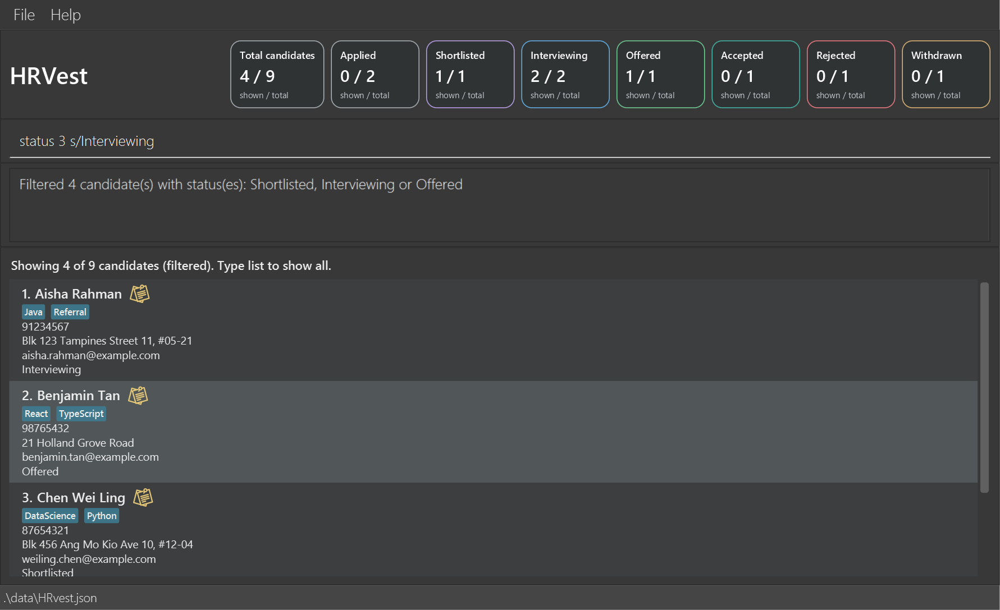
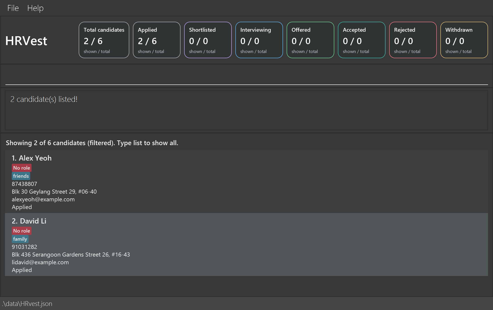

# HRvest User Guide

HRvest is a **desktop address book that helps hiring managers at startups track candidates through the hiring pipeline with less administrative work**. While it has a GUI (Graphical User Interface), most interactions are short typed commands in a CLI (Command Line Interface), so if you type fast, you can work faster than in a mouse-driven applicant tracking system.

<!-- * Table of Contents -->
<page-nav-print />

--------------------------------------------------------------------------------------------------------------------

## Quick start

1. Ensure that Java `25` or later is installed on your computer.<br>
   **Mac users:** Ensure you have the precise JDK version prescribed [here](https://se-education.org/guides/tutorials/javaInstallationMac.html).

1. Download the latest `.jar` file from [here](https://github.com/AY2627S1-CS2103-F10-1/tp/releases).

1. Copy the file to the folder you want to use as the _home folder_ for HRvest.

1. Open a terminal, `cd` to the folder containing the JAR file, and run `java -jar HRvest.jar`.<br>
   A GUI similar to the one below should appear in a few seconds. Note how the app contains some sample data.<br>
   

1. Type a command in the command box and press Enter to execute it. For example, type **`help`** and press Enter to open the help window.<br>
   Some example commands you can try:

   * `list` : Lists all candidates.

   * `add n/John Doe p/98765432 e/johnd@example.com a/John street, block 123, #01-01 r/No role` : Adds a candidate named `John Doe` to HRvest.

   * `delete 3` : Deletes the 3rd candidate shown in the current list.

   * `clear confirm` : Deletes all candidates. `clear` on its own only asks you to confirm.

   * `exit` : Exits the app.

1. Refer to the [Features](#features) section below for details of each command.

--------------------------------------------------------------------------------------------------------------------

## Features

<box type="info" seamless>

**Notes about the command format:**<br>

* Words in `UPPER_CASE` are the parameters to be supplied by the user.<br>
  For example, in `add n/NAME`, replace `NAME` with a value such as `John Doe`.

* Items in square brackets are optional.<br>
  For example, `n/NAME [t/TAG]` can be used as `n/John Doe t/friend` or as `n/John Doe`.

* Items followed by `...` can appear zero or more times.<br>
  For example, `[t/TAG]... ` may be omitted, or written as `t/friend` or `t/friend t/family`.

* Prefixes ignore letter case.<br>
  For example, `S/Offered` is read the same way as `s/Offered`.

* Parameters can be in any order.<br>
  For example, if the command specifies `n/NAME p/PHONE_NUMBER`, `p/PHONE_NUMBER n/NAME` is also acceptable.

* Extraneous parameters for `help`, `list`, `exit`, `export`, and `import` are ignored.<br>
  For example, `help 123` is interpreted as `help`. `clear` accepts only `confirm`, and the `list_role` command rejects all arguments.

* If you are using a PDF version of this document, be careful when copying and pasting commands that span multiple lines as space characters surrounding line-breaks may be omitted when copied over to the application.
</box>

### Accepted characters in candidate inputs

Names, phone numbers, emails, addresses, tags, notes, and `find` keywords accept only **printable ASCII (`U+0020–U+007E`)**: English letters (`A–Z`, `a–z`), digits (`0–9`), ordinary spaces, and ASCII punctuation. This keeps command input within a single, explicit character set. Existing field rules still apply afterward: for example, phone numbers accept only digits, and names do not accept punctuation.

For more information about rejected characters, error messages, and validation scope, see [Command input character validation in the Developer Guide](DeveloperGuide.md#command-input-character-validation).

### Viewing help: `help`

Shows a message explaining how to access the help page.


Format: `help`


### Adding a candidate: `add`

Adds a candidate to HRvest.

Format: `add n/NAME p/PHONE_NUMBER e/EMAIL a/ADDRESS r/ROLE [r/MORE_ROLE]... [s/STATUS] [t/TAG]... `

**Parameters:**

| Parameter | Required? | Accepted values and behavior |
|---|---|---|
| `n/NAME` | Yes | A non-blank name containing only letters, digits, and spaces, e.g. `n/John Doe`. Leading and trailing spaces are removed; internal spaces and letter case are preserved. Punctuation such as apostrophes and hyphens is not accepted. |
| `p/PHONE_NUMBER` | Yes | At least three digits, e.g. `p/98765432`. Spaces within the number, `+`, hyphens, and parentheses are not accepted. Leading zeroes are preserved. |
| `e/EMAIL` | Yes | An address in `local-part@domain` format, e.g. `e/anne.o'brien@example.com`. The local part allows letters, digits, and <code>!#$%&'*+/=?^_&#96;{&#124;}~-</code>, with periods separating non-empty groups. Leading, trailing, and consecutive periods are invalid. Domain labels must start and end with letters or digits and may contain internal hyphens, including consecutive hyphens (e.g. `xn--bcher-kva.de`); the final label must contain at least two characters. Spaces and quoted local parts are not accepted. |
| `a/ADDRESS` | Yes | Any non-blank, printable-ASCII address, e.g. `a/John street, block 123, #01-01`. Spaces and punctuation are allowed. |
| `r/ROLE` | Yes | An existing [role name](#managing-the-role-catalog). Repeat `r/` to assign multiple roles. Matching ignores case and surrounding whitespace. Use `r/No role` if no role applies. |
| `s/STATUS` | No | One of `Applied`, `Shortlisted`, `Interviewing`, `Offered`, `Accepted`, `Rejected`, or `Withdrawn`. Defaults to `Applied` if omitted. Input ignores letter case, so `s/interviewing` is saved and displayed as `Interviewing`. A bare `s/` is invalid rather than using the default. |
| `t/TAG` | No | A non-blank label containing only letters and digits, e.g. `t/backend`. Spaces and punctuation are not accepted. Repeat the prefix for multiple tags: `t/backend t/Java`. Identical tags are removed, but tags are case-sensitive: `t/Java` and `t/java` are distinct. Omit `t/` for no tags; a bare `t/` is invalid when adding. |

**Input and results:**

* Supply each of `n/`, `p/`, `e/`, `a/`, and `s/` at most once. Both `t/` and `r/` can be repeated. Repeated single-valued prefixes are rejected, even if their values are identical.
* Supply valid `n/`, `p/`, `e/`, `a/`, and `r/` values. Missing contact details or text before the first prefix produces an invalid-command-format message.
* Create named roles with `create_role` before assigning them to a candidate. A bare `r/` or an unknown role is rejected.
* Email alone identifies duplicates: surrounding whitespace is trimmed and the whole email is compared case-insensitively. For example, `Alice@Example.com` and `alice@example.com` belong to the same candidate. Adding a duplicate is rejected with `This candidate already exists in HRvest.` Names, phones, addresses, statuses, roles, tags, and notes do not affect duplicate detection. Candidates with the same name but different emails are allowed. Email capitalisation is preserved for display and storage.
* Use only the documented prefixes. Unknown prefixes such as `x/` are treated as part of the preceding value, not as separate fields. A recognised prefix in any letter case preceded by whitespace also starts a new field, even if you intended it to be part of an address. For example, the `N/` in `a/Unit N/A` is read as a second name prefix.
* `no/` is reserved for the `note` command and is rejected anywhere in `add`, in any letter case, including with empty text or after a tab. The error is `The add command does not support no/. Add the candidate first, then use note INDEX no/NOTE_TEXT.` Add the candidate without `no/`, then use their displayed index with `note` to record a note. Text such as `yes/no/feedback` inside an address word remains literal address text.

Examples:

* `add n/John Doe p/98765432 e/johnd@example.com a/John street, block 123, #01-01 r/No role`
* `add n/Betsy Crowe p/1234567 e/betsy@example.com a/Newgate Prison r/Developer s/Interviewing t/backend` (create `Developer` first with `create_role n/Developer`).

### Listing all candidates: `list`

Shows a list of all candidates in HRvest.

Format: `list`

* If HRvest has no candidates, the message is `There are no candidates yet. Use add to add one.`

### Editing a candidate: `edit`

Edits an existing candidate in HRvest.

The success message shows the candidate's updated details.

Format: `edit INDEX [n/NAME] [p/PHONE] [e/EMAIL] [a/ADDRESS] [s/STATUS] [t/TAG]... [r/ROLE]...`

* Edits the candidate at the specified `INDEX`. The index refers to the index number shown in the displayed candidate list. The index **must be a positive integer** 1, 2, 3, ...
* At least one of the optional fields must be provided.
* Existing values will be updated to the input values. The current filter is kept; candidates that no longer match disappear from the displayed list.
* If every value you give matches the candidate's current details, nothing is changed and the message is `No changes made: NAME already has these details.`
* An email matching another candidate's email (ignoring case and surrounding whitespace) is rejected with `This candidate already exists in HRvest.`, even if that candidate is hidden by a filter. The original candidate remains unchanged. Keeping your candidate's email, changing only its capitalisation, or editing other fields does not cause a self-duplicate error.
* Supplied `r/` values replace all existing roles; omitting `r/` preserves them. A bare `r/` is invalid; use `r/No role` to remove named roles. Unknown roles suggest `create_role n/NAME`, and an invalid role leaves all details unchanged.
* When editing tags, all of the candidate's existing tags are removed; adding tags is not cumulative.
* To remove all of a candidate's tags, enter `t/` without a tag after it.
* As in `add`, a recognised prefix in any letter case after a space starts a new field. For example, `edit 1 a/Unit N/A` changes the address to `Unit` and the name to `A`. Check the success message, which shows the updated details.
* `edit` does not change notes. Like `add`, it rejects `no/` anywhere, in any letter case, with `The edit command does not support no/. Use note INDEX no/NOTE_TEXT to add, replace or clear a note.` Use the `note` command instead.

Examples:

*  `edit 1 p/91234567 e/johndoe@example.com` Edits the phone number and email address of the 1st candidate to be `91234567` and `johndoe@example.com` respectively.
*  `edit 2 n/Betsy Crower t/` Edits the name of the 2nd candidate to be `Betsy Crower` and clears all existing tags.
*  `edit 3 s/Interviewing` Updates the status of the 3rd candidate to `Interviewing`.
* `edit 1 r/Developer r/Designer` Replaces the 1st candidate's roles with Developer and Designer, which must already exist.

After an ordinary `edit`, `note`, or `status` update, the current name, status, or role filter remains active. Displayed indexes may change when a candidate stops matching. Expanding a candidate replaces that filter with a selection of the candidate: an update keeps them expanded at index `1`, even if their new name, status, or roles would not match the earlier filter. Check the displayed list before the next index command; use `list` to show all candidates.

### Adding, replacing, or clearing a candidate's note: `note`

Adds a note to the specified candidate, such as interview feedback or follow-up context.

Format: `note INDEX no/[NOTE_TEXT]`

* Adds the note to the candidate at the specified `INDEX`. The index refers to the index number shown in the displayed candidate list. The index **must be a positive integer** 1, 2, 3, ...
* `0` or a negative index gives `Index must be a positive integer.` An index beyond the displayed list gives `The candidate index provided is invalid.` A missing or non-numeric index gives `Invalid command format!`. The current view stays unchanged.
* Each candidate has one note. If the candidate already has a note, it is replaced by the new note.
* To clear the note, enter `note INDEX no/` with no text after `no/`. Whitespace-only text also clears it. The message is `Cleared note for NAME`. Clearing a candidate who already has no note succeeds and keeps that candidate unchanged.
* Non-empty `NOTE_TEXT` can contain at most 500 printable-ASCII characters. Leading and trailing ordinary spaces are removed; spacing, capitalisation, and ASCII punctuation within the note are kept. Tabs, line breaks, and non-ASCII characters are rejected.
* Supply `no/` only once. Because prefixes ignore letter case, a later ` NO/` in the text also counts as a second `no/`. Other prefixes, such as `n/`, are treated as part of the note.
* After the note is updated or cleared, the current filter is kept. When adding or replacing a note, the message is `Updated note for NAME: NOTE_TEXT`.
* Editing a candidate or updating their status keeps their note. Use `expand INDEX` to view the full note.

Examples:

* `note 2 no/Strong on system design, weak on SQL`
* `note 2 no/` clears the 2nd displayed candidate's note. The note icon disappears; expanding the candidate shows `No note recorded.`
* `find Betsy` followed by `note 1 no/Follow up next week` adds a note to the 1st candidate in the results of the `find` command.

<box type="warning" seamless>

**Caution:**
Replacing or removing a note deletes the previous note permanently. To keep earlier information, include it in the new note.
</box>

### Updating a candidate's recruitment status: `status`

Updates the candidate at the given index in the currently displayed list.

Format: `status INDEX s/STATUS`

* `INDEX` is a positive, 1-based index in the displayed list.
* Valid statuses are `Applied`, `Shortlisted`, `Interviewing`, `Offered`, `Accepted`, `Rejected`, and `Withdrawn`, regardless of letter case.
* Candidates created with `add` start with `Applied` unless an initial `s/STATUS` is supplied. Status is saved immediately, shown on the candidate card, and does not affect duplicate checking. Older records without a saved status load as `Applied`; explicitly saved statuses are preserved.
* After an update, the current filter is kept. Candidates that no longer match a status filter disappear from the displayed list. The message is `Updated status of NAME: OLD_STATUS -> NEW_STATUS`.
* `0` or a negative index gives `Index must be a positive integer.` An index beyond the displayed list gives `The candidate index provided is invalid.` A missing or non-numeric index, or a missing `s/`, gives `Invalid command format!`. The candidate and current view stay unchanged.
* An unknown status gives `Status must be one of: Applied, Shortlisted, Interviewing, Offered, Accepted, Rejected, Withdrawn`; repeated `s/` gives `Multiple values specified for the following single-valued field(s): s/`.

Examples:

* `status 3 s/Interviewing`
* `status 1 s/Accepted`

### Locating candidates by name: `find`

Finds candidates with a word in their name that starts with any of the given keywords.

Format: `find KEYWORD [MORE_KEYWORDS]`

* The search is case-insensitive; for example, `hans` matches `Hans`.
* Keyword order does not matter; for example, `Hans Bo` matches `Bo Hans`.
* The search considers only names.
* A keyword matches the start of any word in a name; for example, `Han` matches `Hans`, and `Gru` matches `Hans Gruber`. Text inside a word does not match; for example, `ans` does not match `Hans`.
* Candidates matching at least one keyword are returned (an `OR` search); for example, `Hans Bo` returns `Hans Gruber` and `Bo Yang`.

Examples:
* `find John` returns `john` and `John Doe`
* `find ale` returns `Alex Yeoh`
* `find alex david` returns `Alex Yeoh`, `David Li`<br>
  

### Filtering candidates by status or role: `filter`

Filters candidates by hiring status, assigned roles, or both.

Format: `filter [s/STATUS]... [r/ROLE]...`

* Supply at least one status or role.
* Repeat `s/` or `r/` to match any value within that field (`OR`). Repeated values have no extra effect.
* If both fields are supplied, candidates must match a specified status and a specified role (`AND`).
* Each `filter` replaces the previous search or filter and considers all candidates.
* Valid statuses: `Applied`, `Shortlisted`, `Interviewing`, `Offered`, `Accepted`, `Rejected`, `Withdrawn`.
* Status and role matching ignore case. Role names ignore surrounding whitespace and must exist in the catalog.
* Invalid input leaves the displayed list unchanged. An invalid status lists valid statuses; an unknown role suggests `list_role`.
* If no candidates match, the result count is zero.
* Renaming a role keeps an active filter following that role. Deleting it removes that role's matches.

Examples (create `Developer` and `Designer` first):

* `filter s/Interviewing s/Offered` shows candidates who are interviewing or have been offered a job.
* `filter r/Developer r/Designer` shows candidates assigned to either role.
* `filter r/Developer s/Interviewing s/Offered` shows Developers who are interviewing or have been offered a job.
* `filter r/No role` shows candidates with no named role.

### Deleting a candidate: `delete`

Deletes the specified candidate from HRvest.

The success message shows the deleted candidate's details, including their status.

Format: `delete INDEX`

* Deletes the candidate at the specified `INDEX`.
* The index refers to the index number shown in the displayed candidate list.
* The index **must be a positive integer** 1, 2, 3, ...
* After `expand`, deleting the expanded candidate shows all remaining candidates again.

Examples:

* `list` followed by `delete 2` deletes the 2nd candidate in HRvest.
* `find Betsy` followed by `delete 1` deletes the 1st candidate in the results of the `find` command.

### Viewing a candidate's full record: `expand`

Shows the specified candidate's full record, including their full note.

Format: `expand INDEX`

* Shows the candidate at the specified `INDEX`.
* The index refers to the index number shown in the displayed candidate list.
* The index **must be a positive integer** 1, 2, 3, ... within the displayed list.
* `0` or a negative index gives `Index must be a positive integer.` A non-numeric index gives `Invalid index! Index must be a positive integer.` The current view stays unchanged.
* An index beyond the displayed list gives `No candidate found with that index. Enter an index between 1 and N.`, where `N` is the number of candidates shown. A number above 2147483647 gives `The candidate index provided is invalid.`
* The list shows only the selected candidate at index `1`, with their full note. If the candidate has no note, it shows `No note recorded.` Run `list` to show all candidates again.
* If HRvest has no candidates, the error is `There are no candidates yet. Use add to add one.` If only the displayed list is empty, use `list` or change the filter to display candidates.

Examples:

* `list` followed by `expand 1` shows the 1st candidate in HRvest.
* `filter s/Interviewing` followed by `expand 2` shows the 2nd candidate in the results of the `filter` command.

### Managing the role catalog

The role catalog is the shared collection of roles available in HRvest, including unused roles and the built-in `No role`.

* Each candidate has one or more roles. `add` requires explicit roles; create named roles before assigning them, or use `r/No role`.
* `No role` cannot be renamed or deleted. Assigning any named role removes `No role`, even if both are supplied. It remains the fallback when deleting a candidate's last named role.
* Named roles appear as purple badges, `No role` as a red badge, and tags as blue badges. Long role names wrap.
* Unused roles remain available, including after `clear` and restarts.
* Role command words and prefixes are case-insensitive. Put whitespace before each prefix and supply each required prefix exactly once.
* Changes save automatically. Invalid commands report an error without changing candidates or roles.

**Role names:**

* Names must not be blank or contain control characters such as tabs or newlines. Punctuation and Unicode characters are accepted.
* Matching ignores surrounding whitespace and letter case: ` Software Engineer ` matches `software engineer`. Capitalisation is preserved for display.
* Matching also treats canonically equivalent Unicode spellings as the same name: `Café` with a single accented letter matches `Cafe` followed by a combining acute accent. Display spelling and role IDs are preserved. This applies to creation, assignment, filtering, renaming, and deletion.
* Internal spaces matter: `Software  Engineer` (two spaces) is distinct from `Software Engineer`.
* A space followed by `n/`, `r/`, `p/`, `e/`, `a/`, `t/`, `no/`, or `s/` is reserved command syntax, ignoring case. It cannot appear within a role name; quotes do not escape it.

#### Creating an unused role: `create_role`

Creates a role without assigning it to a candidate.

Format: `create_role n/NAME`

* The name must not match an existing role, including `No role`.

Example: `create_role n/Software Engineer`

#### Renaming a role globally: `edit_role`

Renames a role for every assigned candidate, including those outside the displayed list.

Format: `edit_role r/EXISTING_NAME n/NEW_NAME`

* The role must exist and must not be `No role`.
* The new name must not match another role. Changing only capitalisation is allowed.
* Other role assignments stay unchanged.
* Keeps the current filter or expanded candidate.

Example: `edit_role r/Software Engineer n/Senior Software Engineer`

#### Deleting a role globally: `delete_role`

Removes a role from the catalog and all assigned candidates.

Format: `delete_role r/NAME`

* The role must exist and must not be `No role`.
* Candidates keep their other roles. Those losing their last role receive `No role`.
* Keeps the current filter or expanded candidate.

Example: `delete_role r/Senior Software Engineer`

#### Listing the complete catalog: `list_role`

Shows all role names in the command result, including unused roles and `No role`.

Format: `list_role`

* Names are sorted alphabetically, ignoring case.
* Accepts no arguments and keeps the candidate filter unchanged.

### Clearing all entries: `clear`

Clears all candidates from HRvest while preserving the role catalog, including unused roles.

Format: `clear confirm`

* `clear` on its own deletes nothing. It shows how many candidates would be deleted and asks you to enter `clear confirm`.
* `clear confirm` deletes every candidate, including those hidden by the current `find` or `filter`. The message is `All candidates have been cleared.`
* `confirm` ignores letter case. Any other text after `clear` is rejected.
* If there are no candidates, both forms reply `There are no candidates to clear.`

<box type="warning" seamless>

**Caution:** Clearing cannot be undone. Use `export` first if you may need the candidates again.
</box>

### Exporting candidates: `export`

Exports every candidate to `data/export.csv`, next to the candidate data file `data/HRvest.json` in the folder you run HRvest from. Candidates are exported in address-book order, regardless of the current search or filter. Candidate data, the current filter, and expanded view remain unchanged.

Format: `export`

* Use the lowercase command; surrounding whitespace is accepted.
* The destination is always `data/export.csv`. You are not able to specify your own export path.
* If the data folder does not exist yet (for example, before HRvest has saved any data), `export` creates it.
* The CSV has the columns `name,phone,email,address,status,tags,note`, in that order. Role assignments and the role catalog are not exported; back up both JSON files to preserve them.
* The file is UTF-8 with a byte order mark, so spreadsheet programs such as Excel show accented and non-Latin text correctly.
* For example, the tags `Java` and `backend` appear as `["Java","backend"]` in the tags column when the CSV is opened in a spreadsheet.
* Success displays `Exported successfully to PATH.`, with the absolute destination, only after writing and closing the file succeeds.
* If the address book is empty, `export` succeeds and writes only the header row, with no candidate rows.

<box type="warning" seamless>

**Opening the CSV in a spreadsheet:** The CSV holds your data exactly as stored, but spreadsheet programs change some values when you double-click to open the file:

* Phone numbers lose their leading zeroes, for example `007` becomes `7`.
* Text that starts with `=`, `+`, `-` or `@`, such as an address `=1+2`, is treated as a formula and calculated.

To keep every value as stored, import the file instead. In Excel, use **Data > From Text/CSV**, choose **Transform Data**, and set the columns to **Text** before loading. Do not open exports from untrusted data with formulas enabled.
</box>

**Overwrite warning:** Each successful `export` replaces any existing `export.csv` without asking for confirmation or keeping a backup. This is expected behaviour. It is your responsibility to keep a copy of the exported data: after exporting, copy `export.csv` to a separate location or rename it before running `export` again. Export writes directly to the destination: a failed or interrupted overwrite may destroy the previous export and leave an empty or incomplete CSV.

**For more technical details, you can refer to the** [Developer Guide](./DeveloperGuide.md)

### Importing candidates: `import`

Appends candidates from `import.csv` to all candidates currently loaded in HRvest, preserving existing order and appending new candidates in file order.

Format: `import`

* Extra arguments are ignored, just like `export`. Place `import.csv` in the same directory as the JSON data file and `export.csv`: normally `data/import.csv`. For a configured data file `/app/data/HRvest.json`, the input is `/app/data/import.csv`. No other location is tried.
* The entire import fails if any record is invalid or duplicates an email, ignoring case, in either the CSV or **any** HRvest candidate, including candidates hidden by filters. Records are never skipped or merged.
* CSV accepts legacy Unicode addresses and notes that HRvest can load from JSON and export. Nonblank notes are trimmed and limited to 500 Unicode code points; quoted notes may contain tabs or line breaks. The printable-ASCII policy still applies when entering these values through commands. Other field, duplicate, and import size rules still apply.
* Success displays `Imported N candidates successfully.` (or `Imported 1 candidate successfully.` for one candidate), saves normally, clears filters, exits expanded view, and shows all candidates in the default list view.
* An empty (zero-byte) file or valid header-only file runs the same pipeline, saves normally, resets the view, and reports 0 imported candidates. Whitespace-only files are invalid.
* Only readable regular files are accepted; symbolic links, directories, and special files are rejected.
* Finish saving `import.csv` before running import and leave it unchanged until import finishes. Editing, replacing, or deleting it during import is unsupported usage with unpredictable results.
* `import.csv` is never modified. On failure, HRvest reports the error and restores the pre-import in-memory data, filter, and expanded view, including any pre-existing unsaved changes.

Use this template to prepare `data/import.csv`. Save it as UTF-8 CSV, keep the header unchanged, and replace the example row with your candidate's details. An empty note means no note; use `[]` for no tags.

```csv
"name","phone","email","address","status","tags","note"
"Example Candidate","01234567","candidate@example.com","123 Example Road","Applied","[]",""
```

**For more import details, including CSV formatting and validation rules, see the** [Developer Guide](DeveloperGuide.md#import-csv-format-and-validation).

**Import limits:** Limits are enforced while reading/parsing; exceeding any limit rejects the whole import with an error.

| Resource | Maximum |
|------|------|
| File | 10 MiB (10,485,760 bytes) |
| Candidates in one import | 10,000, excluding the header |
| Decoded field | 65,536 Unicode characters before trimming |
| Note | 500 Unicode code points after trimming |
| Tags per candidate | 100 array entries before deduplication |
| Each tag name | 256 Unicode characters before trimming |
| Tag JSON structure | One flat array of strings only |

These are import limits, not new add/edit restrictions. Files exceeding them cannot be imported even if their contents originated in HRvest.

### Exiting the program: `exit`

Exits the program.

Format: `exit`

### Candidate note indicator

A pinned sticky note icon beside a candidate's name indicates that a note exists. Hovering over it shows `Note available`. Collapsed cards keep the note text hidden; use `expand INDEX` to view the candidate's full note. Candidates without notes have no icon and reserve no icon space.

### Header summary cards

The **HRvest** text logo appears above the command box. When the window is wide enough, as it is when HRvest first opens on most screens, a row beside it shows **Total candidates** and one card for each recruitment status: Applied, Shortlisted, Interviewing, Offered, Accepted, Rejected, and Withdrawn.

* Each card shows **shown / total**: the number in the currently displayed candidate list versus the number among all candidates loaded in HRvest. For example, `2 / 8` on Interviewing means two interviewing candidates are currently shown, out of eight overall.
* Searching, filtering, or expanding a candidate changes the shown counts; overall counts still include candidates hidden from the list. Use `list` to show all candidates again.
* Adding, updating, deleting, or clearing candidates updates the counts automatically. Statuses with no candidates still have a card, and an empty data set shows `0 / 0` on every card.
* The cards appear together on one row only when every card fits at its minimum width. If the window is too narrow, the entire row disappears while the logo stays visible. Widen the window to restore all cards with up-to-date counts.

### Displayed candidate count

The line above the candidate list shows how many candidates are displayed, so you can tell when some are hidden rather than deleted:

* `Showing all 6 candidates.` when every candidate is displayed, or `Showing 1 candidate.` when HRvest has only one.
* `Showing 2 of 6 candidates (filtered). Type list to show all.` when `find`, `filter`, or a later update to a filtered list hides some candidates.
* `Expanded view of 1 of 6 candidates. Type list to show all.` after `expand`, or `Expanded view of the only candidate.` when HRvest has only one.
* `No candidates.` when HRvest has no candidates.

### Navigating command history

The command box remembers every command you submit in the current session so you can re-run or edit a past command without retyping it.

* `Up` moves back through your submitted commands. Repeated presses walk further into the past; the earliest entry stays shown once you reach it.
* `Down` moves forward. Pressing past the newest entry restores whatever draft you were typing before you started navigating, or clears the box if there was no draft.
* Both successful and rejected commands are recorded. A rejected command also stays in the command box, shown in red, so you can fix a typo and press Enter again; `Up` then shows the command before it. A command identical to the most recent one does not take up an extra slot.
* Blank submissions are skipped. History is session-scoped and holds up to the 100 most recent commands. Repeating an earlier command that is not the most recent one takes another slot.

### Saving the data

HRvest automatically saves data after each command that changes candidates or the role catalog, and after every successful import. Viewing, searching, filtering, help, exit, and commands that leave the stored data unchanged do not rewrite the data files. Use [`export`](#exporting-candidates-export) to create a CSV copy.

If HRvest cannot create its log file, it prints a warning and continues logging to the terminal. This does not grant access to candidate files: any data-file permission errors still need to be resolved.

* Keep both `data/HRvest.json` (candidates) and `data/roles.json` (roles) when backing up or restoring data.
* HRvest allows only one instance to use a data folder at a time. A second instance stops before reading or writing candidate data or preferences and shows an error dialog asking you to close the first. Dismiss the dialog to exit the second instance. Your account needs permission to access the files and write to their folder.
* Keep `data/.hrvest.lock` in place. HRvest releases the operating-system lock when it closes or its process terminates; the file remains and does not prevent restarting. Do not delete or replace it while HRvest is running. Separate HRvest folders can run independently.
* If saving fails, follow the error message before continuing. Do not edit or delete `roles-transaction.json`; restart HRvest to recover an interrupted save.
* A failed data change is rolled back. You can still inspect the loaded candidates, open help, export a copy, or exit through the command box when JSON saving is unavailable. Exit does not retry a rejected change.

### Editing the data file

Advanced users may edit the JSON files in the `data` folder.

**Before editing:**

1. Complete any interrupted-save recovery, then close HRvest.
1. Back up both data files together.
1. Edit the files, then restart HRvest to check your changes.

**When editing records:**

* Keep candidate emails unique, ignoring case.
* Role names must be unique ignoring case and Unicode composition. If an older catalog contains both composed and decomposed spellings of the same name, loading rejects the catalog and backs up both files. In copies of the backups, give one entry a distinct name, keep its ID and candidate assignments, then restore the candidate and catalog files together.
* Each file must contain exactly one JSON object. Do not repeat a property name within an object or append another object or text after it. Surrounding JSON whitespace is allowed. Invalid JSON follows the backup and recovery process below.
* A supplied `roles` array must contain at least one valid role ID from `roles.json`, without duplicates. Omitting `roles` loads `No role`; an empty array is invalid. Loading a mix of `no-role` and named role IDs removes `no-role`. Use `no-role` for `No role`, rather than its display name.
* Preserve the JSON structure and use the same field values allowed by commands. To clear a note, set `note` to an empty string.
* One invalid value in **any** candidate, such as a space between the digits of a phone number, stops the whole file from loading. HRvest then starts with an empty candidate list, as described below. Spaces around a value are removed, as they are in commands.
* Save the file as UTF-8, the default in most editors. "UTF-8 with BOM" also works, but other encodings, such as UTF-16 (shown as "Unicode" in some versions of Notepad), cannot be loaded.

**If data cannot be loaded:**

<box type="warning" seamless>

Invalid edits can cause HRvest to start with an empty candidate list and the default role catalog. HRvest backs up the existing files first and shows their location. If backup or recovery fails, follow the reported instructions and keep all original and recovery files.

1. Close HRvest and copy the backups shown in the warning.
1. Repair the copies and restore the corresponding candidate and role files together.
1. Restart HRvest and verify your data before deleting any backups.

HRvest does not repair or merge records automatically. See the [Developer Guide](DeveloperGuide.md#storage-component) for storage and recovery details.

</box>

### Archiving data files `[coming in v2.0]`

_Details coming soon ..._

--------------------------------------------------------------------------------------------------------------------

## FAQ

**Q**: How do I transfer my data to another computer?<br>
**A**: Install HRvest on the new computer, then:

1. If `roles-transaction.json` exists on the old computer, restart HRvest there to complete recovery first. If recovery fails, follow the reported instructions before transferring.
1. Close HRvest on both computers.
1. Copy `data/HRvest.json` and `data/roles.json` from the old HRvest folder to the new one, replacing both files together.

--------------------------------------------------------------------------------------------------------------------

## Known issues

1. **When using multiple screens**, if you move the application to a secondary screen, and later switch to using only the primary screen, the GUI will open off-screen. The remedy is to delete the `preferences.json` file created by the application before running the application again.
2. **If you minimize the Help Window** and then run the `help` command (or use the `Help` menu, or the keyboard shortcut `F1`) again, the original Help Window will remain minimized, and no new Help Window will appear. The remedy is to manually restore the minimized Help Window.

--------------------------------------------------------------------------------------------------------------------

## Command summary

Action     | Format, Examples
-----------|----------------------------------------------------------------------------------------------------------------------------------------------------------------------
**Add**    | `add n/NAME p/PHONE_NUMBER e/EMAIL a/ADDRESS r/ROLE [r/MORE_ROLE]... [s/STATUS] [t/TAG]... ` <br> e.g., `add n/James Ho p/22224444 e/jamesho@example.com a/123, Clementi Rd, 1234665 r/No role t/friend t/colleague`
**Create role** | `create_role n/NAME`<br> e.g., `create_role n/Software Engineer`
**Edit role** | `edit_role r/EXISTING_NAME n/NEW_NAME`<br> e.g., `edit_role r/Software Engineer n/Senior Engineer`
**Delete role** | `delete_role r/NAME`<br> e.g., `delete_role r/Software Engineer`
**List roles** | `list_role`
**Clear**  | `clear confirm`
**Delete** | `delete INDEX`<br> e.g., `delete 3`
**Edit**   | `edit INDEX [n/NAME] [p/PHONE_NUMBER] [e/EMAIL] [a/ADDRESS] [s/STATUS] [t/TAG]... [r/ROLE]... `<br> e.g.,`edit 2 n/James Lee e/jameslee@example.com`
**Export** | `export`
**Import** | `import`
**Filter** | `filter [s/STATUS]... [r/ROLE]...`<br> e.g., `filter s/Interviewing s/Offered`
**Find**   | `find KEYWORD [MORE_KEYWORDS]`<br> e.g., `find James Jake`
**List**   | `list`
**Note**   | `note INDEX no/[NOTE_TEXT]`<br> e.g., `note 2 no/Passed round 2, schedule final interview` or `note 2 no/` to clear
**Status** | `status INDEX s/STATUS`<br> e.g., `status 3 s/Interviewing`
**Help**   | `help`
