# HRvest User Guide

HRvest is a **desktop application that helps hiring managers at startups track candidates through the hiring pipeline with less administrative work**. It is built for managers who hire for a few roles at a time, track roughly 10 to 50 candidates and type fast. While it has a GUI (Graphical User Interface), most interactions are short typed commands in a CLI (Command Line Interface), so you can work faster than in a mouse-driven applicant tracking system.

<!-- * Table of Contents -->
<page-nav-print />

<box type="tip">

**Tip:** Click a panel title (a line with an arrow) to expand it. Panels hold the detailed rules and error messages for a command. Their text is hidden until you open them, so your browser's search (Ctrl+F) will not find it until you do. The panels with the most important error messages are already open.
</box>

--------------------------------------------------------------------------------------------------------------------

## Quick start

1. Ensure that Java `25` or later is installed on your computer.<br>
   **Mac users:** Ensure you have the precise JDK version prescribed [here](https://se-education.org/guides/tutorials/javaInstallationMac.html).

1. Download the latest `.jar` file from [here](https://github.com/AY2627S1-CS2103-F10-1/tp/releases).

1. Copy the file to the folder you want to use as the _home folder_ for HRvest.

1. Open a terminal, `cd` to the folder containing the JAR file, and run `java -jar HRvest.jar`.<br>
   A GUI similar to the one below should appear in a few seconds, listing some sample candidates.<br>
   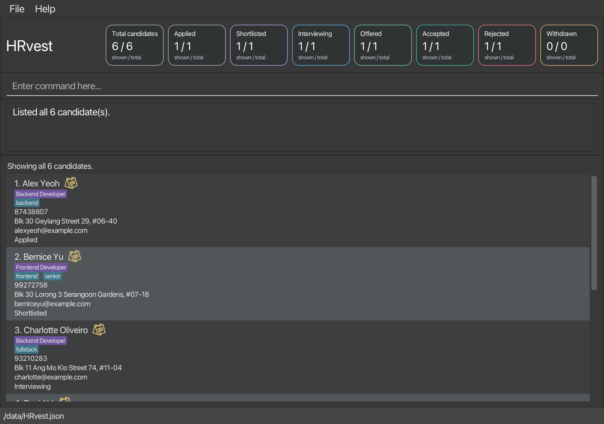

1. Type a command in the command box and press Enter to execute it. For example, type **`help`** and press Enter to open the help window.<br>
   Some example commands you can try:

   * `list` : Lists all candidates.

   * `add n/John Doe p/98765432 e/johnd@example.com a/John street, block 123, #01-01 r/No role` : Adds a candidate named `John Doe` to HRvest.

   * `delete 3` : Deletes the 3rd candidate shown in the current list.

   * `clear confirm` : Deletes all candidates. `clear` on its own only asks you to confirm.

   * `exit` : Exits the app.

1. Refer to [Understanding the screen](#understanding-the-screen) and the [Commands](#commands) section below for details of each command, and [Your data](#your-data) for saving and editing the data file.

<box type="info">

**Note:** When a command gives several fields, such as the `add` example above, HRvest shows `Warning: Prefixes read as additional fields: ...` before the success message. This is normal: the warning lists every prefix after the first field so that you can spot text read as a field by accident. The command has still succeeded. See [Typing values](#typing-values).
</box>

<box type="tip">

**Tip:** The sample candidates appear only when HRvest has no saved data yet. Run `clear confirm` to start with an empty list, then add your own candidates.
</box>

--------------------------------------------------------------------------------------------------------------------

## Understanding the screen

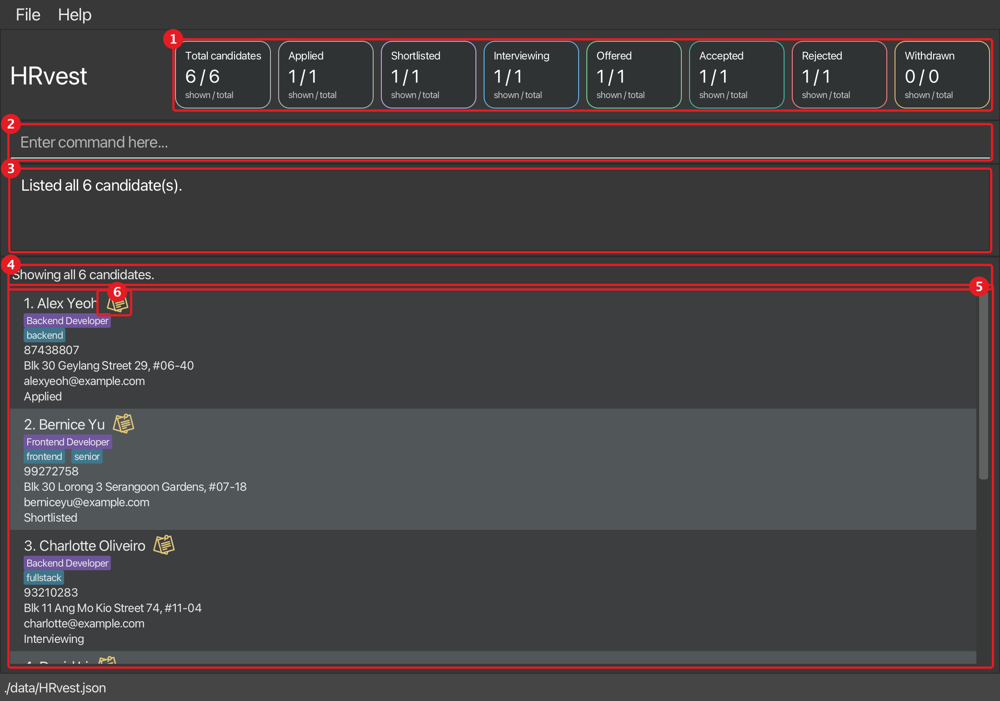

1. **Summary cards:** Total candidates and one card per recruitment status.
1. **Command box:** Type a command here and press Enter. A rejected command stays here, shown in red, so you can fix it.
1. **Result box:** The outcome of your last command, or the reason it was rejected.
1. **Count line:** How many candidates are displayed, so you can tell when some are hidden rather than deleted.
1. **Candidate list:** Each card shows the candidate's index, name, roles (purple badges; `No role` is red), tags (blue badges), phone, address, email and status.
1. **Note icon:** A sticky note beside a name means the candidate has a note. Hover over it to see `Note available`. Use `expand INDEX` to read the note.

<box type="tip">

**Tip:** The summary cards (1) and the count line (4) show when a search or filter is hiding candidates. Type `list` to show everyone again.
</box>

<panel header="Summary cards in detail" type="seamless">

The **HRvest** logo appears above the command box. When the window is wide enough, as it is when HRvest first opens on most screens, a row beside it shows **Total candidates** and one card for each status: Applied, Shortlisted, Interviewing, Offered, Accepted, Rejected and Withdrawn.

* Each card shows **shown / total**: the number in the displayed list versus all candidates loaded in HRvest. For example, `2 / 8` on Interviewing means two interviewing candidates are shown, out of eight overall.
* Searching, filtering or expanding changes the shown counts; overall counts still include hidden candidates. Use `list` to show all candidates again.
* Adding, updating, deleting or clearing candidates updates the counts automatically. Statuses with no candidates still have a card, and an empty data set shows `0 / 0` on every card.
* The cards appear together on one row only when every card fits at its minimum width. If the window is too narrow, the whole row disappears while the logo stays. Widen the window to bring it back.
</panel>

<panel header="Count line messages" type="seamless">

* `Showing all 6 candidates.` when every candidate is displayed, or `Showing 1 candidate.` when HRvest has only one.
* `Showing 2 of 6 candidates (filtered). Type list to show all.` when `find`, `filter` or a later update to a filtered list hides some candidates.
* `Expanded view of 1 of 6 candidates. Type list to show all.` after `expand`, or `Expanded view of the only candidate.` when HRvest has only one.
* `No candidates.` when HRvest has no candidates.
</panel>

<panel header="Command history (Up and Down keys)" type="seamless">

The command box remembers the commands you submit in the current session so you can re-run or edit one without retyping it.

* `Up` moves back through your submitted commands; the earliest entry stays shown once you reach it.
* `Down` moves forward. Pressing past the newest entry restores the draft you were typing before you started navigating, or clears the box if there was none.
* Successful and rejected commands are both recorded. After a rejected command, `Up` shows the command before it. A command identical to the most recent one does not take up an extra slot.
* Blank submissions are skipped. History lasts for the current session and holds up to the 100 most recent commands. Repeating an earlier command that is not the most recent one takes another slot.
</panel>

<panel header="The note icon in detail" type="seamless">

Collapsed cards keep the note text hidden; only the icon shows. Candidates without notes have no icon and reserve no icon space.
</panel>

--------------------------------------------------------------------------------------------------------------------

## Commands

<box type="info">

**Notes about the command format:**

* Words in `UPPER_CASE` are the parameters to be supplied by the user.<br>
  For example, in `add n/NAME`, replace `NAME` with a value such as `John Doe`.

* Items in square brackets are optional.<br>
  For example, `n/NAME [t/TAG]` can be used as `n/John Doe t/friend` or as `n/John Doe`.

* Items followed by `...` can appear zero or more times.<br>
  For example, `[t/TAG]...` may be omitted, or written as `t/friend` or `t/friend t/family`.

* Command words and prefixes ignore letter case.<br>
  For example, `LIST` is read the same way as `list`, and `S/Offered` the same way as `s/Offered`.

* Parameters can be in any order.<br>
  For example, `p/PHONE_NUMBER n/NAME` is also acceptable for `n/NAME p/PHONE_NUMBER`. `INDEX` must come right after the command word: `status 2 s/Offered` works, but `status s/Offered 2` does not. The other exception is an address starting with `L` or `P`, which cannot come directly after the name: `edit 1 a/L Street n/John` works, but `edit 1 n/John a/L Street` is rejected. See [Typing values](#typing-values).

* `INDEX` is the number shown beside a candidate in the **currently displayed list**, and must be a positive integer (1, 2, 3, ...).

* Extraneous parameters for `help`, `list`, `exit`, `export` and `import` are ignored. For example, `help 123` is interpreted as `help`. `clear` accepts only `confirm`, and `list_role` rejects all arguments.

</box>

<box type="warning">

**Check your list before using an index.** `edit`, `note`, `status`, `delete` and `expand` all act on the displayed list, which changes after `find`, `filter`, `expand` and updates that make a candidate stop matching. Look at the list, then pick the index. Use `list` to show all candidates again.
</box>

### Common rules

**Filters and expanded view.** After `edit`, `note`, `status` or `edit_role`/`delete_role`, the current name search, status filter or role filter stays active. Candidates that no longer match disappear from the displayed list, so displayed indexes may change. `expand` replaces the current filter with a selection of one candidate at index `1`. Updating the expanded candidate keeps them selected at index `1`, even if their new details would not match the earlier filter.

**Index errors.** The command is rejected and the current view stays unchanged.

| Mistake | Message |
|---|---|
| `0` or a negative index (`edit`, `note`, `status`, `expand`, `delete`) | `Index must be a positive integer.` |
| Index beyond the displayed list (`edit`, `note`, `status`, `delete`) | `The candidate index provided is invalid.` |
| Index beyond the displayed list (`expand`) | `No candidate found with that index. Enter an index between 1 and N.`, where `N` is the number of candidates shown. A number above 2147483647 gives `The candidate index provided is invalid.` |
| Missing or non-numeric index (`edit`, `note`, `status`, `delete`) | `Invalid command format!` followed by the usage |
| Non-numeric index (`expand`) | `Invalid index! Index must be a positive integer.` |

### Typing values

* Names, phone numbers, emails, addresses, tags, notes and `find` keywords accept **printable ASCII only**. Type accented names in plain letters (`José` as `Jose`).
* A prefix such as `n/` after a space starts a new field, in any letter case. To keep text like `N/A` inside a value, type `\/` for its slash: `edit 1 a/Unit N\/A`.
* An upper-case prefix right after a lower-case field, such as the `N/` in `edit 1 a/Unit N/A`, could be text or a new field, so the command is rejected and nothing changes. The rejected command stays in the command box in red so you can fix it.

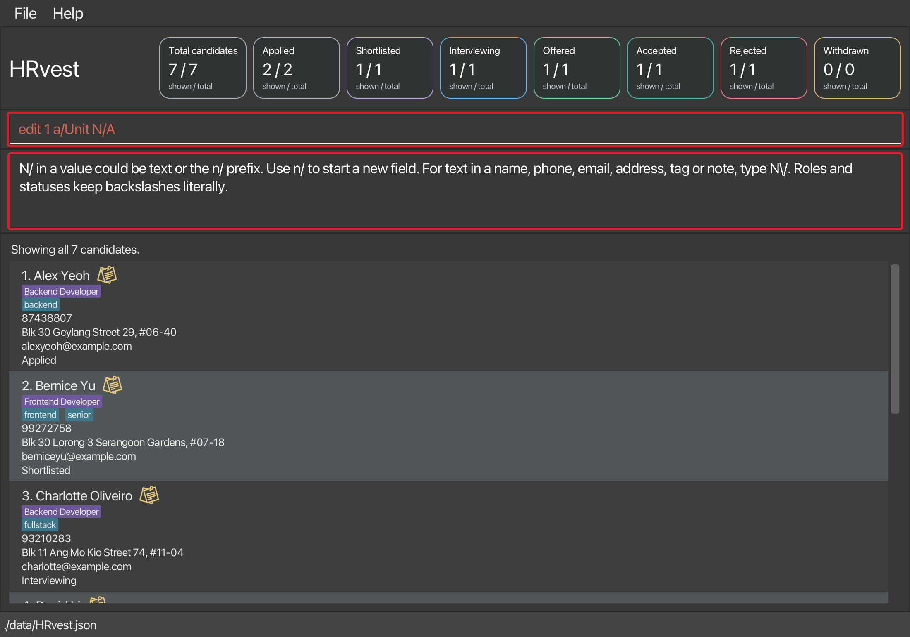

<panel header="Accepted characters" type="seamless" expanded>

Names, phone numbers, emails, addresses, tags, notes and `find` keywords accept only printable ASCII (`U+0020–U+007E`): English letters (`A–Z`, `a–z`), digits (`0–9`), ordinary spaces and ASCII punctuation. This keeps command input within a single, explicit character set. Accented letters, emoji, curly quotes, tabs, line breaks, non-breaking spaces and zero-width spaces are rejected, even when copied text looks normal. Enter accented or non-Latin names such as `José` or `陈` in romanised form, e.g. `Jose`. Existing rules still apply afterward: phone numbers need at least three digits, and names accept only the punctuation used in legal names. For the technical rationale, see [Command input character validation](DeveloperGuide.md#command-input-character-validation) in the Developer Guide.
</panel>

<panel header="Text that looks like a prefix, and the multi-field warning" type="seamless">

A prefix such as `n/` that follows a space starts a new field, in any letter case. To keep prefix-looking text such as `N/A` inside a value, type `\/` for its slash.

* `edit 1 a/Unit N\/A` sets the address to `Unit N/A`. This works in names, phone numbers, emails, addresses, tags and notes, where every `\/` you type is saved as `/`.
* Role names and statuses keep backslashes literally. To assign an existing role named `N/A`, use `edit 1 r/N/A` with no space after `r/`; `r/ N/A` is ambiguous, and `r/N\/A` refers to a different role whose name contains a backslash.
* In `add`, `edit` and `note`, an upper-case prefix that follows a lower-case one, such as the `N/` in `edit 1 a/Unit N/A` or the `T/` in `a/Unit T/2`, could be text or a new field, so HRvest rejects the command and changes nothing (`a/Unit T\/2` saves the address `Unit T/2`). The error offers `n/` to start a field and `N\/` for literal text. If that field is already supplied and cannot be repeated, as in `edit 1 n/Bob a/Unit N/A`, it does not offer another `n/` field. Escaping does not bypass the field's validation rules.
* A lower-case prefix inside a value, such as `a/Unit n/a`, still starts a field: `edit 1 a/Unit n/a` changes the address to `Unit` and the name to `a`, with a warning listing `n/`. Use `edit 1 a/Unit n\/a` to keep it in the address.
* Successful `add` and `edit` commands with several fields show a warning before the success message, listing every prefix after the first field in input order, including lower-case and repeated ones. For example, `edit 1 A/Unit N/A` changes the address to `Unit` and the name to `A`, with `Warning: Prefixes read as additional fields: N/.` The command is applied and saved immediately; the warning does not ask for confirmation or prevent an unintended edit, so check the updated details. It also appears for intentional multi-field commands and unchanged edits (`edit 1 A/Unit P/123 N/A` lists both `P/` and `N/`). A single-field edit produces no warning, and escaped text and legal-name connectors are not listed: `edit 1 A/Unit N\/A` saves the whole address without a warning.
</panel>

<panel header="Name rules (add and edit)" type="seamless">

* **Punctuation between letters or digits:** apostrophes, periods, hyphens and slashes are accepted, for example `Anne O'Brien`, `J.R. Tan`, `Kelly-Ann Tan` and `Ravi s/o Kumar`.
* **Other legal-name forms:** a word may end with one period (`Tan Ah Kow Jr.`). A comma may follow a word or closing parenthesis, but must be followed by a space and another word (`Martin Luther King, Jr.` or `Tan (Kelvin), Jr.`); a trailing comma is rejected. Parenthesised words are accepted after the first word (`Tan Wei Ming (Kelvin)`), and a separate `@` may introduce an alias (`Mohamed Ali @ Ahmad`). Parentheses must enclose complete words with no spaces immediately inside them, and `@` needs a name on both sides.
* **Name markers:** `s/o`, `d/o`, `a/l`, `a/p` and `l/p` are accepted; slashes between letters or digits are not limited to these. Within a name, `s/o` followed by a space stays part of the name rather than starting a status field, in any letter case. `d/o` and `l/p` stay in the name because `d/` and `l/` are not command prefixes.
* **Names and addresses:** `a/l` and `a/p` can look like an address field, so when using them in a name, put the address first, for example `edit 1 a/1 Road n/Siti a/p Ahmad` or `edit 1 a/9 Road n/Siti a/p Ahmad`. A later address is also accepted if another field, such as `p/`, separates it from the name. An address beginning with `L` or `P` can look like a name marker, so put the address first (`edit 1 a/L Street n/John`). An ambiguous sequence such as `edit 1 n/John a/L Street a/9 Road` is rejected rather than guessed.
* **Rejected:** other punctuation, repeated punctuation such as `O''Brien`, and punctuation-only words.
* **Spacing:** leading and trailing spaces are removed; internal spaces and letter case are preserved.
</panel>

### Viewing help: `help`

Shows a message explaining how to access the help page.


Format: `help`

### Adding a candidate: `add`

Adds a candidate to HRvest.

Format: `add n/NAME p/PHONE_NUMBER e/EMAIL a/ADDRESS r/ROLE [r/MORE_ROLE]... [s/STATUS] [t/TAG]...`

| Parameter | Required? | What to enter |
|---|---|---|
| `n/NAME` | Yes | A name following the [name rules](#typing-values), e.g. `n/John Doe` |
| `p/PHONE_NUMBER` | Yes | Printable-ASCII text with at least three digits; spaces, `+`, brackets and labels are allowed, e.g. `p/+65 9123 4567` |
| `e/EMAIL` | Yes | `local-part@domain`, e.g. `e/anne.o'brien@example.com` |
| `a/ADDRESS` | Yes | Any non-blank printable-ASCII text, e.g. `a/John street, block 123, #01-01` |
| `r/ROLE` | Yes | An existing [role](#managing-the-role-catalog); repeat `r/` for several. Use `r/No role` if none applies |
| `s/STATUS` | No | `Applied`, `Shortlisted`, `Interviewing`, `Offered`, `Accepted`, `Rejected` or `Withdrawn`; defaults to `Applied` |
| `t/TAG` | No | A short label, e.g. `t/C++` or `t/machine learning`; repeat `t/` for several |

* Supply each of `n/`, `p/`, `e/`, `a/` and `s/` at most once; `t/` and `r/` can be repeated. Repeated single-valued prefixes are rejected, even with identical values.
* An email already used by another candidate is rejected (see the details below).

<box type="info">

**Note:** A successful `add` with several fields starts with `Warning: Prefixes read as additional fields: ...`, as in the screenshot below. It is a reminder, not an error: check that the details in the success message are what you meant.
</box>

<box type="tip">

**Tip:** Create named roles with `add_role` before assigning them, or use `r/No role`. An unknown role or a bare `r/` is rejected.
</box>

Examples:

* `add n/John Doe p/98765432 e/johnd@example.com a/John street, block 123, #01-01 r/No role`
* `add n/Betsy Crowe p/1234567 e/betsy@example.com a/Newgate Prison r/Developer s/Interviewing t/backend` (create `Developer` first with `add_role n/Developer`).

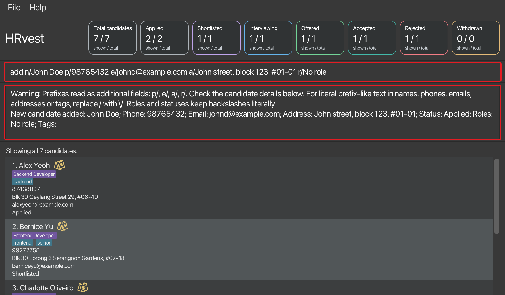

<panel header="Phone, email, status and tag details" type="seamless">

* **Phone:** accepted examples are `p/+65 9123 4567`, `p/(65) 6123 4567` and `p/1234 5678 (HP) 1111-3333 (Office)`. Formatting, extensions and contact labels are accepted. Leading and trailing spaces are removed; internal text and leading zeroes are preserved. HRvest does not check whether a number is dialable.
* **Email:** the local part allows letters, digits and <code>!#$%&'*+/=?^_&#96;{&#124;}~-</code>, with periods separating non-empty groups; leading, trailing and consecutive periods are invalid. Domain labels must start and end with a letter or digit and may contain internal hyphens, including consecutive ones (`xn--bcher-kva.de`); the final label must have at least two characters. Spaces and quoted local parts are not accepted.
* **Address:** spaces and punctuation are allowed.
* **Role:** matching ignores case and surrounding whitespace.
* **Status:** input ignores letter case, so `s/interviewing` is saved and shown as `Interviewing`. A bare `s/` is invalid rather than using the default.
* **Tags:** a non-blank printable-ASCII label, including punctuation and internal spaces, e.g. `t/C#`, `t/.NET`, `t/Node.js`, `t/machine learning`. Surrounding spaces are trimmed; internal spaces are preserved. Tags are case-sensitive: `t/Java` and `t/java` are distinct. Omit `t/` for no tags; a bare `t/` is invalid when adding. Repeat the prefix for several tags: `t/C++ t/machine learning`. Slashes without a preceding prefix boundary are allowed, e.g. `t/C/C++`. A recognised prefix preceded by a space starts another field even inside a tag: `t/machine learning n/Alice` sets the tag to `machine learning` and the name to `Alice`. Quoting does not escape prefixes.
</panel>

<panel header="Errors, duplicates and unknown prefixes" type="seamless" expanded>

* The error message lists all missing required parameters together. Bare `add` reports `Missing n/NAME, p/PHONE_NUMBER, e/EMAIL, a/ADDRESS, r/ROLE. Use r/No role if no role applies.` The command `add n/John Doe r/No role` reports `Missing p/PHONE_NUMBER, e/EMAIL, a/ADDRESS.`
* **Duplicates:** email alone identifies duplicates. Surrounding whitespace is trimmed and the whole email is compared ignoring case, so `Alice@Example.com` and `alice@example.com` are the same candidate. A duplicate is rejected with `Another candidate (NAME) already uses this email.`, where `NAME` is the existing matching record, even if hidden by a filter. Nothing is changed. Names, phones, addresses, statuses, roles, tags and notes do not affect duplicate detection, so two candidates with the same name but different emails are allowed. Email capitalisation is preserved for display and storage.
* **Unknown prefixes** such as `x/` are treated as part of the preceding value, not as separate fields. A recognised prefix preceded by whitespace starts a new field even inside an address: `a/Unit n/a` sets the name to `a`. The only exceptions are the name connectors `s/o`, `a/l` and `a/p` within `n/NAME`. See [Typing values](#typing-values) for how to keep such text.
* `no/` is reserved for the `note` command and is rejected anywhere in `add`, in any letter case, including with empty text or after a tab. The error is `The add command does not support no/. Add the candidate first, then use note INDEX no/NOTE_TEXT.` Add the candidate without `no/`, then use their displayed index with `note` to record a note. Text such as `yes/no/feedback` inside an address word remains literal address text.
</panel>

### Listing all candidates: `list`

Shows all candidates in HRvest, along with the total count.

Format: `list`

* The message is `Listed all N candidate(s).`, where `N` is the current number of candidates. For example, `Listed all 6 candidate(s).`
* If HRvest has no candidates, the message is `There are no candidates yet. Use add to add one.`

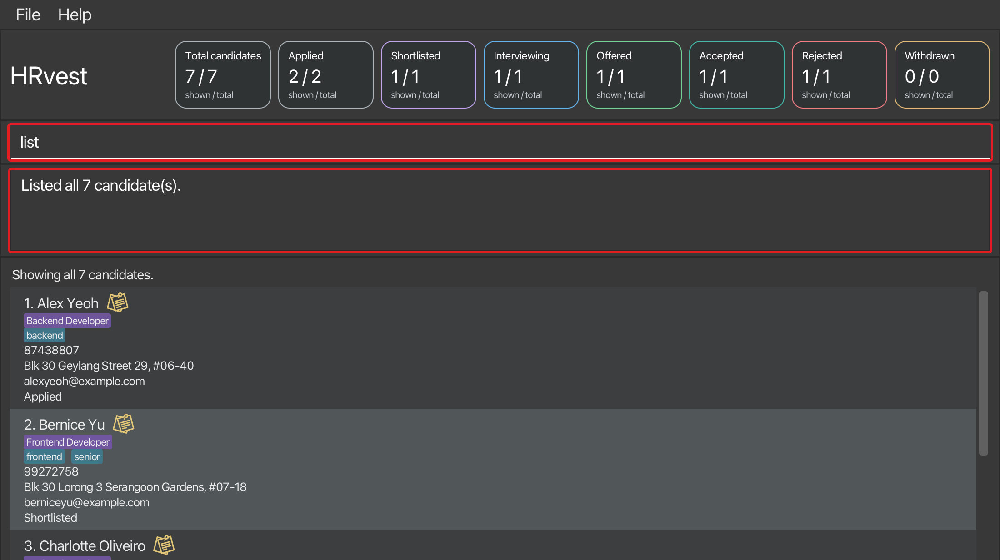

### Editing a candidate: `edit`

Edits an existing candidate in HRvest. The success message shows the candidate's updated details.

Format: `edit INDEX [n/NAME] [p/PHONE_NUMBER] [e/EMAIL] [a/ADDRESS] [s/STATUS] [t/TAG]... [r/ROLE]...`

* Edits the candidate at the specified `INDEX` in the displayed list. At least one optional field must be provided.
* Existing values are replaced by the input values.
* Keeps the current filter or expanded view (see [common rules](#common-rules)).
* `edit` does not change notes; use the `note` command.

<box type="warning">

**Caution:** `edit` **replaces** roles and tags instead of adding to them. Supplied `r/` values replace all existing roles (omit `r/` to keep them; a bare `r/` is invalid, so use `r/No role` to remove named roles). Supplied `t/` values replace all existing tags; enter `t/` with nothing after it to remove all tags. To keep existing ones, include them again.
</box>

Examples:

* `edit 1 p/91234567 e/johndoe@example.com` edits the phone number and email address of the 1st candidate.
* `edit 2 n/Betsy Crower t/` edits the name of the 2nd candidate and clears all existing tags.
* `edit 3 s/Offered` updates the status of the 3rd candidate to `Offered`.
* `edit 1 r/Developer r/Designer` replaces the 1st candidate's roles with Developer and Designer, which must already exist.

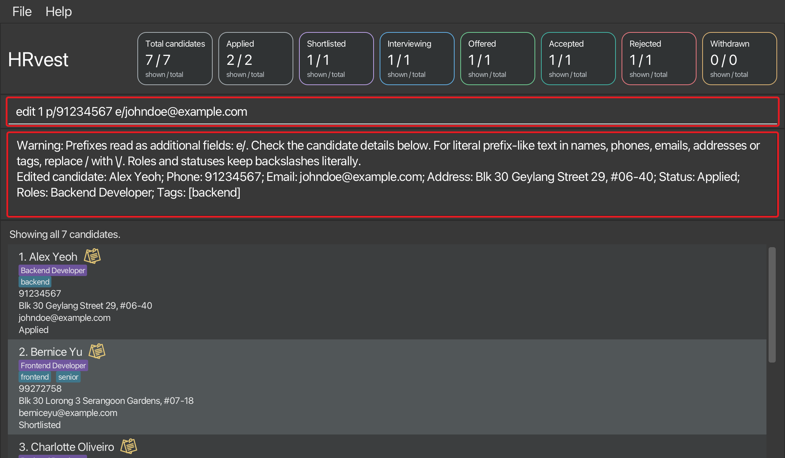

<panel header="Unchanged edits, duplicate emails, role errors and prefix pitfalls" type="seamless" expanded>

* If every value you give matches the candidate's current details, nothing is changed and the message is `No changes made: NAME already has these details.`
* An email matching another candidate's email (ignoring case and surrounding whitespace) is rejected with `Another candidate (NAME) already uses this email.`, where `NAME` is the matching existing record rather than the submitted name, even if hidden by a filter. The original candidate, filter and expanded view stay unchanged. Keeping your candidate's own email, changing only its capitalisation, or editing other fields does not cause a self-duplicate error.
* An unknown role suggests `add_role n/NAME`, and an invalid role leaves all details unchanged.
* As in `add`, a recognised prefix after a space starts a new field, and an upper-case prefix after a lower-case one is rejected. For example, `edit 1 a/Unit N/A` reports that `N/` could be text or the `n/` prefix, and changes nothing. Use `edit 1 a/Unit N\/A` to set the address to `Unit N/A`. See [Typing values](#typing-values).
* To avoid confusing an address beginning with `L` or `P` with a legal-name marker, put the address first, e.g. `edit 1 a/L Street n/John`. An ambiguous sequence such as `edit 1 n/John a/L Street a/9 Road` is rejected without changing the candidate.
* `edit` rejects `no/` anywhere, in any letter case, with `The edit command does not support no/. Use note INDEX no/NOTE_TEXT to add, replace or clear a note.`
</panel>

### Adding, replacing, or clearing a candidate's note: `note`

Adds a note to the specified candidate, such as interview feedback or follow-up context.

Format: `note INDEX no/[NOTE_TEXT]`

* Each candidate has one note. A new note replaces the old one.
* To clear the note, enter `note INDEX no/` with no text after `no/`.
* `NOTE_TEXT` can contain at most 500 printable-ASCII characters.
* Keeps the current filter or expanded view. Editing a candidate or updating their status keeps their note. Use `expand INDEX` to read the full note.

Examples:

* `note 2 no/Strong on system design, weak on SQL`
* `note 2 no/` clears the 2nd displayed candidate's note. The note icon disappears; expanding the candidate shows `No note recorded.`
* `find Betsy` followed by `note 1 no/Follow up next week` adds a note to the 1st candidate in the `find` results.

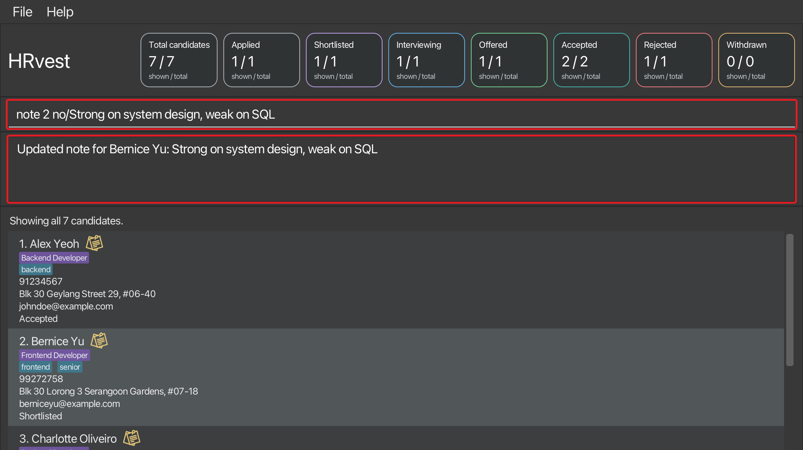

<box type="warning">

**Caution:** Replacing or removing a note deletes the previous note permanently. To keep earlier information, include it in the new note.
</box>

<panel header="Messages and input rules for notes" type="seamless" expanded>

* When adding or replacing a note, the message is `Updated note for NAME: NOTE_TEXT`. When clearing, it is `Cleared note for NAME`. Clearing a candidate who has no note succeeds and changes nothing. Text containing only ordinary spaces also clears the note.
* Leading and trailing ordinary spaces are removed; spacing, capitalisation and ASCII punctuation within the note are kept. Tabs, line breaks and non-ASCII characters are rejected.
* Supply `no/` only once. A later ` no/` or ` NO/` in the text is rejected as a second `no/`; type `no\/` to keep that text in the note. Other prefixes, such as `n/`, are treated as part of the note.
* Index errors are listed in the [common rules](#common-rules). A missing `no/` is reported before an invalid index.
</panel>

### Updating a candidate's recruitment status: `status`

Updates the status of the candidate at the given index in the displayed list.

Format: `status INDEX s/STATUS`

* Valid statuses are `Applied`, `Shortlisted`, `Interviewing`, `Offered`, `Accepted`, `Rejected` and `Withdrawn`, regardless of letter case.
* The message is `Updated status of NAME: OLD_STATUS -> NEW_STATUS`.
* If the candidate already has that status, the message is `No change: NAME already has status STATUS.` and nothing changes.
* Keeps the current filter or expanded view.

Examples:

* `status 3 s/Interviewing`
* `status 1 s/Accepted`

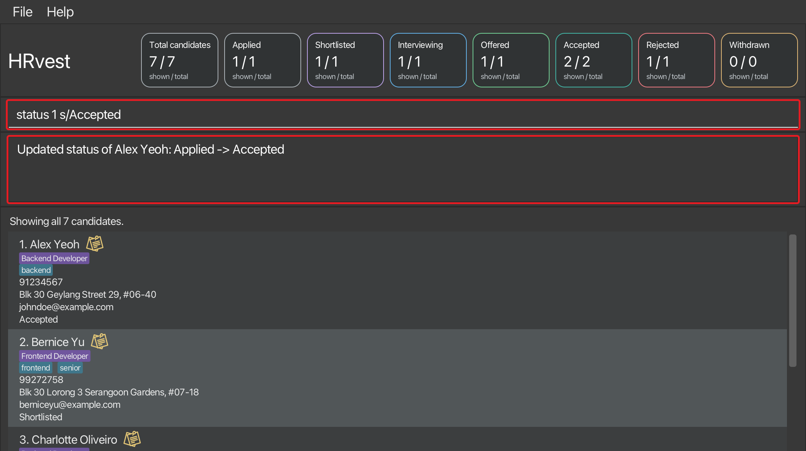

<panel header="Defaults and error messages for status" type="seamless" expanded>

* Candidates created with `add` start as `Applied` unless an initial `s/STATUS` is supplied. Status is saved immediately, shown on the candidate card, and does not affect duplicate checking. Older records without a saved status load as `Applied`; explicitly saved statuses are preserved.
* A missing `s/` gives `Invalid command format!`. An unknown status gives `Status must be one of: Applied, Shortlisted, Interviewing, Offered, Accepted, Rejected, Withdrawn`; repeated `s/` gives `Multiple values specified for the following single-valued field(s): s/`. The candidate and current view stay unchanged. Index errors are in the [common rules](#common-rules).
</panel>

### Locating candidates by name: `find`

Finds candidates with a word in their name that starts with any of the given keywords.

Format: `find KEYWORD [MORE_KEYWORDS]...`

* The search is case-insensitive (`hans` matches `Hans`) and keyword order does not matter (`Hans Bo` matches `Bo Hans`).
* Only names are searched. A keyword matches the **start** of any word in a name: `Han` matches `Hans`, and `Gru` matches `Hans Gruber`, but text inside a word does not match (`ans` does not match `Hans`).
* Candidates matching at least one keyword are returned (an `OR` search): `Hans Bo` returns `Hans Gruber` and `Bo Yang`.

<box type="info">

**Note:** Each `find` replaces the previous search or filter and considers all candidates, so `find` and `filter` cannot be combined. For example, `filter s/Interviewing` followed by `find Alex` shows every candidate matching `Alex`, whatever their status.
</box>

Examples:

* `find ROY` returns `Roy Balakrishnan`
* `find ale` returns `Alex Yeoh`
* `find alex david` returns `Alex Yeoh`, `David Li`

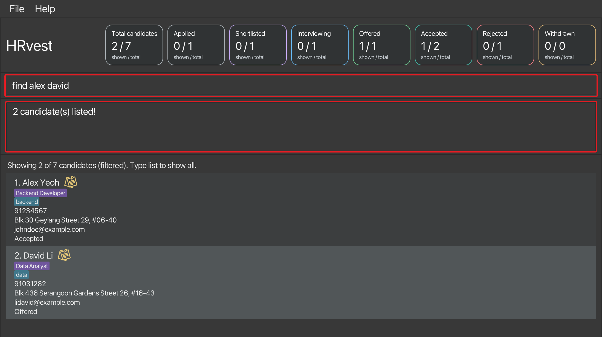

<panel header="Parentheses and commas in names" type="seamless">

Parentheses and commas in names and keywords are ignored, so both `find Kelvin` and `find (Kelvin)` match `Tan Wei Ming (Kelvin)`, and `find King,` matches `Martin Luther King, Jr.`. Keywords containing only parentheses and commas match no candidates.
</panel>

### Filtering candidates by status or role: `filter`

Filters candidates by hiring status, assigned roles, or both.

Format: `filter [s/STATUS]... [r/ROLE]...`

* Supply at least one status or role.
* Repeat `s/` or `r/` to match any value within that field (`OR`). If both fields are supplied, a candidate must match a specified status **and** a specified role (`AND`).
* Valid statuses: `Applied`, `Shortlisted`, `Interviewing`, `Offered`, `Accepted`, `Rejected`, `Withdrawn`. Status and role matching ignore case. Roles must exist in the catalog.
* Invalid input leaves the displayed list unchanged. If no candidates match, the result count is zero.

<box type="info">

**Note:** Each `filter` replaces the previous search or filter and considers all candidates, so `filter` and `find` cannot be combined. For example, `find Alex` followed by `filter r/Developer` shows every Developer, not only those matching `Alex`.
</box>

Examples (create `Developer` and `Designer` first):

* `filter s/Interviewing s/Offered` shows candidates who are interviewing or have been offered a job.
* `filter r/Developer r/Designer` shows candidates assigned to either role.
* `filter r/Developer s/Interviewing s/Offered` shows Developers who are interviewing or have been offered a job.
* `filter r/No role` shows candidates with no named role.

Before and after `filter s/Interviewing s/Offered`:

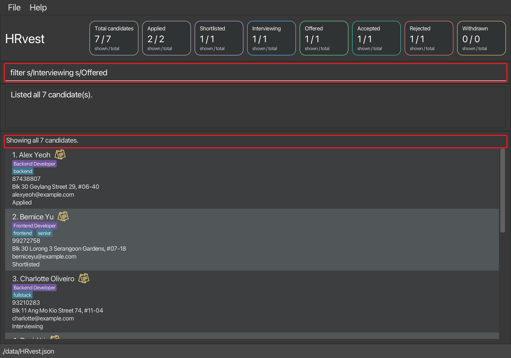

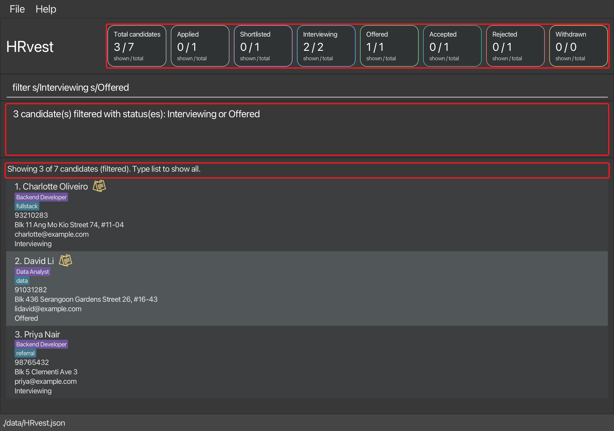

<panel header="Errors and role changes while filtering" type="seamless">

* An invalid status lists the valid statuses; an unknown role suggests `list_role`. Other prefixes are rejected, for example `filter n/Alex` gives `The filter command does not support n/. Use only s/STATUS and r/ROLE.`
* Repeated values have no extra effect. Role names ignore surrounding whitespace.
* Renaming a role keeps an active filter following that role. Deleting it removes that role's matches.
</panel>

### Deleting a candidate: `delete`

Deletes the specified candidate from HRvest. The success message shows the deleted candidate's details, including their status.

Format: `delete INDEX`

* Deletes the candidate at the specified `INDEX` in the displayed list.
* After `expand`, deleting the expanded candidate shows all remaining candidates again.

<box type="warning">

**Caution:** Deleting a candidate also deletes their note, and cannot be undone. Use `export` first if you may need the record again.
</box>

Examples:

* `list` followed by `delete 2` deletes the 2nd candidate in HRvest.
* `find Betsy` followed by `delete 1` deletes the 1st candidate in the `find` results.

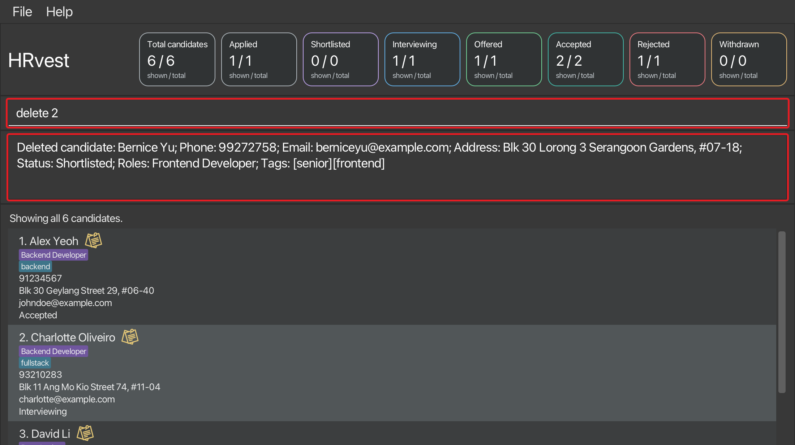

### Viewing a candidate's full record: `expand`

Shows the specified candidate's full record, including their full note.

Format: `expand INDEX`

* The list shows only the selected candidate at index `1`, with their full note, or `No note recorded.` if there is none. Run `list` to show all candidates again.

Examples:

* `list` followed by `expand 1` shows the 1st candidate in HRvest.
* `filter s/Interviewing` followed by `expand 2` shows the 2nd candidate in the `filter` results.

Before and after `expand 1`:

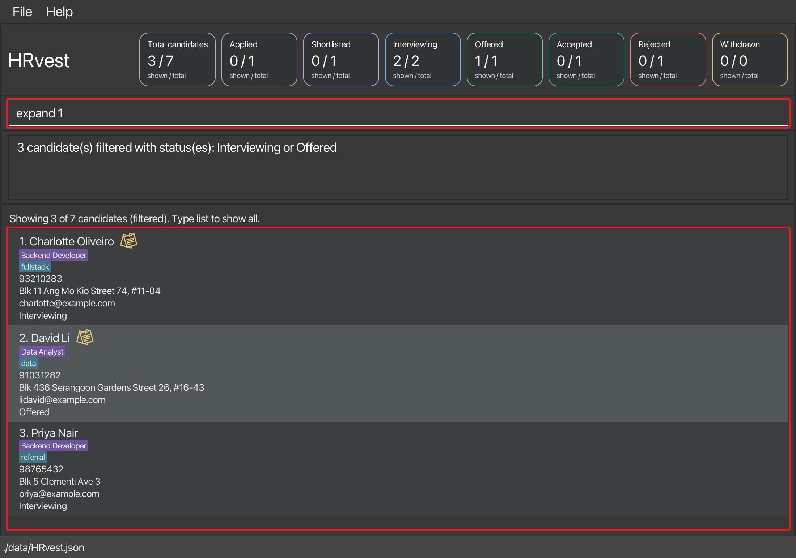

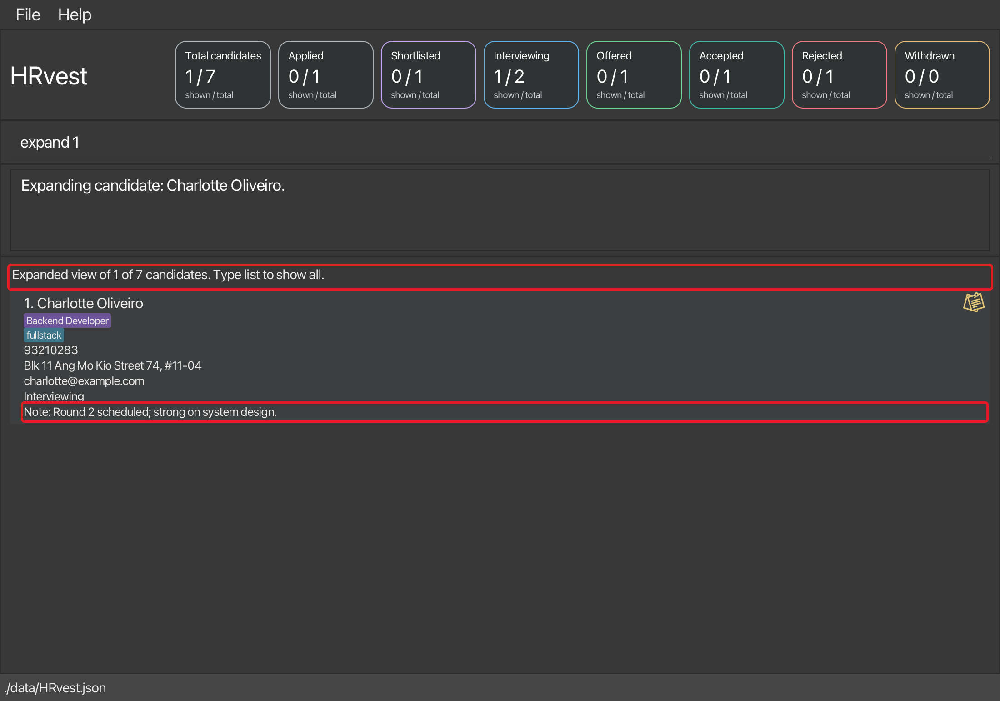

<panel header="When there are no candidates" type="seamless">

If HRvest has no candidates, the error is `There are no candidates yet. Use add to add one.` If only the displayed list is empty, use `list` or change the filter to display candidates. Index errors are in the [common rules](#common-rules).
</panel>

### Managing the role catalog

The role catalog is the shared collection of roles available in HRvest, including unused roles and the built-in `No role`.

* Each candidate has one or more roles. `add` requires explicit roles; create named roles before assigning them, or use `r/No role`.
* `No role` cannot be renamed or deleted. Assigning any named role removes `No role`, even if both are supplied. It comes back when you delete a candidate's last named role.
* Unused roles remain available, including after `clear` and restarts. Long role names wrap on the candidate card.
* Changes save automatically. Invalid commands report an error without changing candidates or roles.

<panel header="Role name rules" type="seamless">

* Names must not be blank or contain control characters such as tabs or newlines. Printable ASCII characters, including punctuation, are accepted.
* Invisible characters, such as no-break spaces (`U+00A0`) and zero-width spaces (`U+200B`), are rejected, even when text copied from a web page looks normal. Use ordinary spaces.
* For supported ASCII role names, matching ignores surrounding spaces and letter case: ` Software Engineer ` matches `software engineer`. Capitalisation is preserved for display. This applies to creation, assignment, filtering, renaming and deletion. Display spelling and role IDs are preserved.
* Internal spaces matter: `Software  Engineer` (two spaces) is distinct from `Software Engineer`.
* A space followed by `n/`, `r/`, `p/`, `e/`, `a/`, `t/`, `no/` or `s/` is reserved command syntax, ignoring case. It cannot appear within a role name, and quotes do not escape it. A `\/` in a role name is kept as typed.
* Role command words and prefixes are case-insensitive. Put whitespace before each prefix and supply each required prefix exactly once.
</panel>

#### Creating an unused role: `add_role`

Creates a role without assigning it to a candidate.

Format: `add_role n/NAME`

* The name must not match an existing role, including `No role`.

Example: `add_role n/Software Engineer`

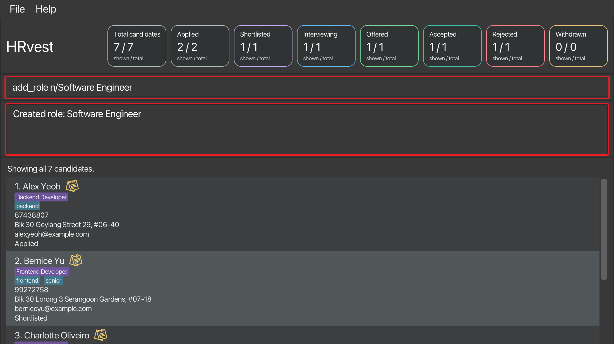

#### Renaming a role globally: `edit_role`

Renames a role for every assigned candidate, including those outside the displayed list.

Format: `edit_role r/EXISTING_NAME n/NEW_NAME`

* The role must exist and must not be `No role`. The new name must not match another role, but changing only capitalisation is allowed.
* Other role assignments stay unchanged. Keeps the current filter or expanded view.

Example: `edit_role r/Software Engineer n/Senior Software Engineer`

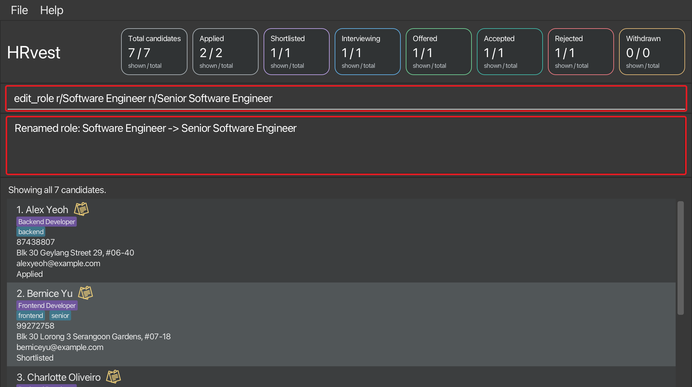

#### Deleting a role globally: `delete_role`

Removes a role from the catalog and from all assigned candidates.

Format: `delete_role r/NAME`

* The role must exist and must not be `No role`.
* Candidates keep their other roles. Those losing their last role receive `No role`. Keeps the current filter or expanded view.

<box type="warning">

**Caution:** The role is removed from every candidate who has it, and this cannot be undone.
</box>

Example: `delete_role r/Senior Software Engineer`

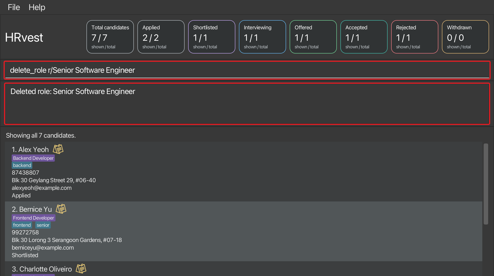

#### Listing the complete catalog: `list_role`

Shows all role names in the result box, including unused roles and `No role`.

Format: `list_role`

* Names are sorted alphabetically, ignoring case. Accepts no arguments and keeps the candidate filter unchanged.
* The result box grows to show more role names while leaving space for candidate cards. Large catalogs and long names remain scrollable.

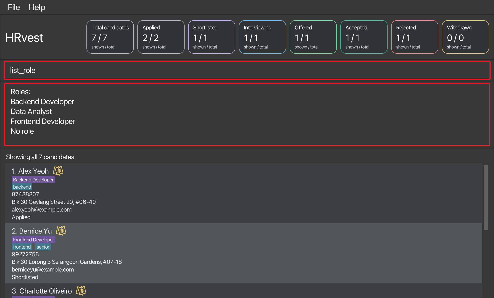

### Clearing all entries: `clear`

Clears all candidates from HRvest while preserving the role catalog, including unused roles.

Format: `clear confirm`

* `clear` on its own deletes nothing. It shows how many candidates would be deleted and asks you to enter `clear confirm`.
* `clear confirm` deletes every candidate, including those hidden by the current `find` or `filter`. The message is `All candidates have been cleared.`
* `confirm` ignores letter case. Any other text after `clear` is rejected. If there are no candidates, both forms reply `There are no candidates to clear.`

`clear` first asks you to confirm, then `clear confirm` deletes the candidates:

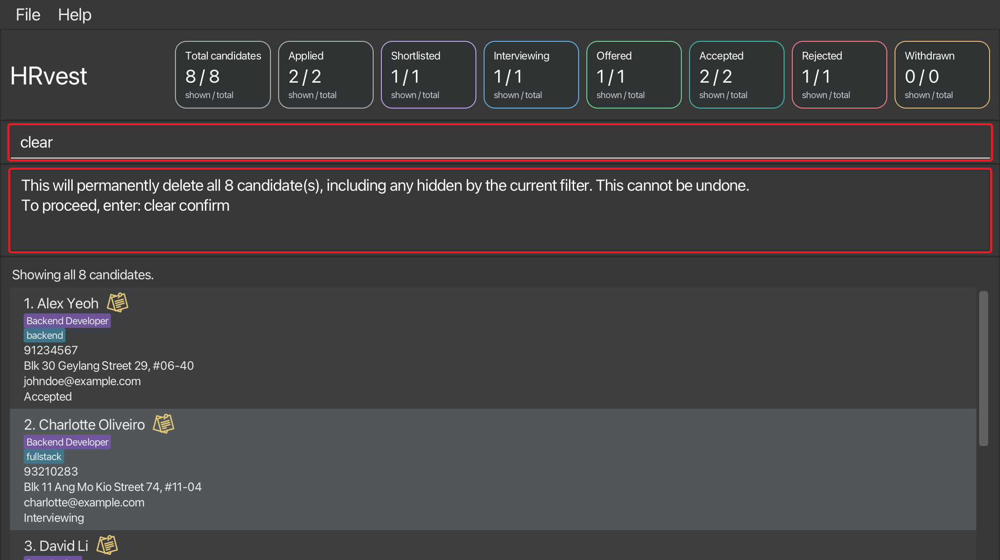

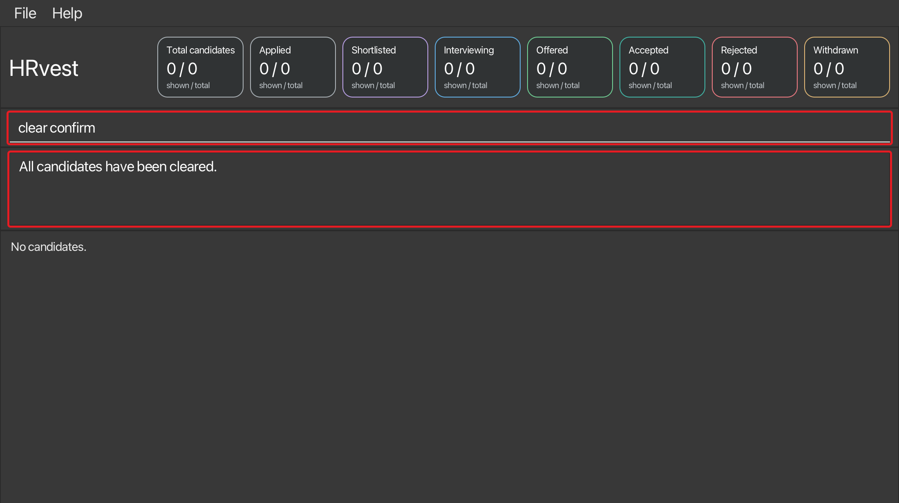

<box type="warning">

**Caution:** Clearing cannot be undone. Use `export` first if you may need the candidates again.
</box>

### Exporting candidates: `export`

Exports every candidate to `data/export.csv`, next to the data file `data/HRvest.json`, in the folder you run HRvest from. Candidates are exported in the order of the full candidate list, regardless of the current search or filter, and your data, filter and expanded view are unchanged.

Format: `export`

* The destination is always `data/export.csv`; you cannot choose another path. If the `data` folder does not exist yet, `export` creates it.
* The CSV has the columns `name,phone,email,address,status,tags,note,roles`, in that order.
* Success displays `Exported successfully to PATH.` with the absolute destination, only after the file has been written and closed. If HRvest has no candidates, `export` writes only the header row.

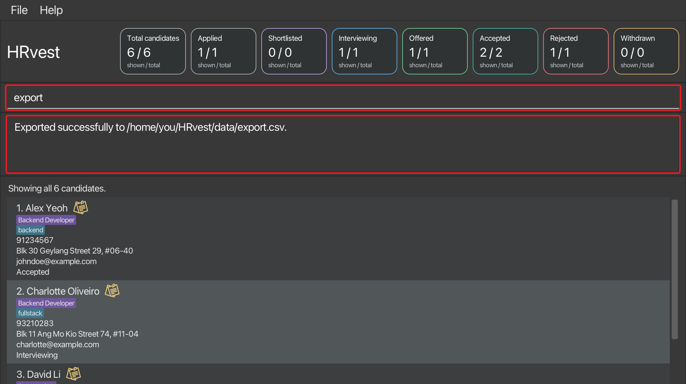

<box type="warning">

**Overwrite warning:** Each successful `export` replaces any existing `export.csv` without asking and without a backup. Copy or rename the CSV first if you need to keep it.
</box>

<panel header="CSV contents and opening it in a spreadsheet" type="seamless">

* Tags appear as a list such as `["Java","backend"]` in the tags column. Roles appear the same way, in `list_role` order, such as `["Designer","Developer"]`, or `["No role"]` for a candidate without a named role. Unused roles are not exported, so back up both JSON files to keep the complete role catalog.
* The file is UTF-8 with a byte order mark (a hidden marker at the start of the file), so spreadsheet programs such as Excel show accented and non-Latin text correctly.
* Surrounding whitespace after `export` is accepted.
* HRvest writes a temporary file and then atomically replaces `export.csv`, so a failed export leaves the previous CSV intact. An interrupted export may leave a `HRvest-export-*.tmp` file in the data folder; after closing HRvest you may delete it. A filesystem that cannot replace files in one step reports an export error.

**Opening the CSV in a spreadsheet.** The CSV holds your data exactly as stored, but spreadsheet programs change some values when you double-click to open the file:

* Phone numbers lose their leading zeroes, for example `007` becomes `7`.
* Text that starts with `=`, `+`, `-` or `@`, such as an address `=1+2`, is treated as a formula and calculated.

To keep every value as stored, import the file instead. In Excel, use **Data > From Text/CSV**, choose **Transform Data**, and set the columns to **Text** before loading. Do not open exports from untrusted data with formulas enabled.

For more technical details, see the [Developer Guide](DeveloperGuide.md#csv-export).
</panel>

### Importing candidates: `import`

Appends candidates from `import.csv` to the candidates already in HRvest, keeping existing order and adding new candidates in file order.

Format: `import`

* Place `import.csv` in the `data` folder beside `HRvest.json` and `export.csv`, that is `data/import.csv` in the folder you run HRvest from. The location cannot be changed, and no other location is tried.
* The `roles` column lists at least one role name; use `["No role"]` if none applies. A name that matches no existing role is created as a new role, so an export can be imported into an HRvest that does not have its roles yet.
* Success displays `Imported N candidates successfully.` (or `Imported 1 candidate successfully.`), saves, clears filters, leaves expanded view and shows all candidates in the default list view. If the import created roles, the message names them, for example `Imported 2 candidates successfully. Created role: QA.`
* `import.csv` is never modified. On failure, HRvest reports the error and restores your data, filter and expanded view as they were before the import, including any pre-existing unsaved changes.

<box type="info">

**Note:** The **entire import fails** if any record is invalid or duplicates an email (ignoring case) in the CSV or in **any** HRvest candidate, including those hidden by filters. Records are never skipped or merged.
</box>

Use this template to prepare `data/import.csv`. Save it as UTF-8 CSV, keep the header unchanged, and replace the example row with your candidate's details. An empty note means no note; use `[]` for no tags and `["No role"]` for no role.

```csv
"name","phone","email","address","status","tags","note","roles"
"Example Candidate","01234567","candidate@example.com","123 Example Road","Applied","[]","","[""No role""]"
```

Running `import` with that file in place:

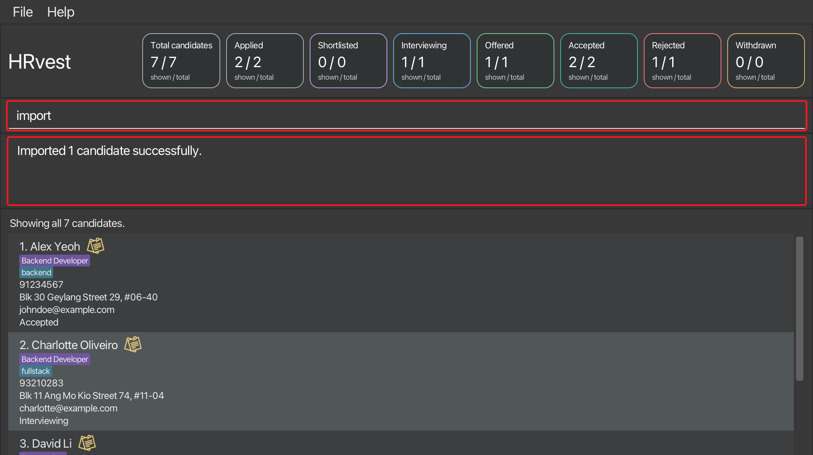

<panel header="Import limits" type="seamless">

Limits are enforced while reading the file; exceeding any limit rejects the whole import with an error. These are import limits, not new `add`/`edit` restrictions. Files exceeding them cannot be imported even if their contents originated in HRvest.

| Resource | Maximum |
|------|------|
| File | 10 MiB (10,485,760 bytes) |
| Candidates in one import | 10,000, excluding the header |
| Decoded field | 65,536 Unicode characters before trimming |
| Note | 500 Unicode code points after trimming |
| Tags or roles per candidate | 100 entries each, before removing repeats |
| Each tag or role name | 256 characters before trimming |
| Tag and role list format | One flat list of strings only |
</panel>

<panel header="More import rules" type="seamless">

* Other field, duplicate and import size rules still apply. Extra arguments after `import` are ignored. An empty (zero-byte) file or a valid header-only file imports 0 candidates, saves normally and resets the view. Whitespace-only files are invalid.
* Only readable regular files are accepted; symbolic links, directories and special files are rejected.
* Finish saving `import.csv` before running `import` and leave it unchanged until the import finishes. Editing, replacing or deleting it during import gives unpredictable results.
* Names, phones, emails, addresses, tags and nonblank notes must contain only printable ASCII (`U+0020–U+007E`), as when entered through commands. Tabs, line breaks and non-ASCII characters are rejected even inside quoted fields or before trimming. An empty or whitespace-only note means no note; other notes are trimmed and limited to 500 characters.
* Names match existing roles ignoring case and surrounding whitespace, as in `add`, and follow the same [role name rules](#managing-the-role-catalog). A role name containing an invisible character is rejected with its CSV record and `roles` field identified, and no candidates or roles from that file are added.
* For CSV formatting and validation rules, see the [Developer Guide](DeveloperGuide.md#import-csv-format-and-validation).
</panel>

### Exiting the program: `exit`

Exits the program.

Format: `exit`

--------------------------------------------------------------------------------------------------------------------

## Your data

### Saving the data

HRvest automatically saves data after each command that changes candidates or the role catalog, and after every successful import. Viewing, searching, filtering, help, exit and commands that leave the stored data unchanged do not rewrite the data files. Use [`export`](#exporting-candidates-export) to create a CSV copy.

* Keep both `data/HRvest.json` (candidates) and `data/roles.json` (roles) when backing up or restoring data.
* HRvest allows only one running instance per data folder. A second instance stops before reading or writing candidate data or preferences and shows an error dialog asking you to close the first; dismiss the dialog to exit the second instance. Your account needs permission to access the files and write to their folder.
* If saving fails, follow the error message before continuing. A failed data change is rolled back, and you can still inspect the loaded candidates, open help, export a copy, or exit when saving is unavailable. Exit does not retry a rejected change.

<panel header="Lock file, interrupted saves and log files" type="seamless">

* Keep `data/.hrvest.lock` in place. HRvest releases the operating-system lock when it closes or its process terminates; the file remains and does not prevent restarting. Do not delete or replace it while HRvest is running. Separate HRvest folders can run independently.
* Do not edit or delete `roles-transaction.json` after an interrupted save; restart HRvest to recover.
* If HRvest cannot create its log file, it prints a warning and continues logging to the terminal. This does not grant access to candidate files: any data-file permission errors still need to be resolved.
</panel>

### Editing the data file

Advanced users may edit the JSON files in the `data` folder. Invalid edits can make HRvest start with an empty candidate list.

**Before editing:**

1. Complete any interrupted-save recovery, then close HRvest.
1. Back up both data files together.
1. Edit the files, then restart HRvest to check your changes.

<box type="warning">

**Caution:** One invalid value in **any** candidate, such as a phone number with fewer than three digits, stops the whole file from loading. HRvest then starts with an empty candidate list and the default role catalog, after backing up your files and showing their location.
</box>

<panel header="Rules for editing the files" type="seamless">

* Keep candidate emails unique, ignoring case.
* Role names must be unique ignoring case and Unicode composition. If an older catalog contains both composed and decomposed spellings of the same name, loading rejects the catalog and backs up both files. In copies of the backups, give one entry a distinct name, keep its ID and candidate assignments, then restore the candidate and catalog files together.
* Each file must contain exactly one JSON object. Do not repeat a property name within an object or append anything after it. Surrounding whitespace is allowed. Invalid JSON follows the backup and recovery process below.
* A supplied `roles` array must contain at least one valid role ID from `roles.json`, without duplicates. Omitting `roles` loads `No role`; an empty array is invalid. Use `no-role` for `No role`, not its display name. Loading a mix of `no-role` and named role IDs removes `no-role`.
* In `roles.json`, keep the entry with the ID `no-role` and the name `No role`. Give each role you add a new, unique ID in UUID format (a standard unique identifier), such as `3f2b6c1e-8d4a-4b7e-9c2f-1a2b3c4d5e6f`. Any other ID, or a missing or renamed `no-role` entry, stops both files from loading.
* Preserve the JSON structure and use the same field values that commands allow. To clear a note, set `note` to an empty string. Spaces around a value are removed, as in commands.
* Save as UTF-8, the default in most editors. "UTF-8 with BOM" also works, but other encodings, such as UTF-16 (shown as "Unicode" in some versions of Notepad), cannot be loaded.
</panel>

<panel header="If data cannot be loaded" type="seamless">

HRvest backs up the existing files first and shows their location. If backup or recovery fails, follow the reported instructions and keep all original and recovery files.

1. Close HRvest and copy the backups shown in the warning.
1. Repair the copies and restore the corresponding candidate and role files together.
1. Restart HRvest and verify your data before deleting any backups.

HRvest does not repair or merge records automatically. See the [Developer Guide](DeveloperGuide.md#storage-component) for storage and recovery details.
</panel>

--------------------------------------------------------------------------------------------------------------------

## FAQ

**Q**: How do I transfer my data to another computer?<br>
**A**: Install HRvest on the new computer, then:

1. If `roles-transaction.json` exists on the old computer, restart HRvest there to complete recovery first. If recovery fails, follow the reported instructions before transferring.
1. Close HRvest on both computers.
1. Copy `data/HRvest.json` and `data/roles.json` from the old HRvest folder to the new one, replacing both files together.

**Q**: Why did my `edit` or `delete` change the wrong candidate?<br>
**A**: Indexes refer to the list currently displayed. After `find`, `filter` or `expand`, the numbers change. Check the list before you type an index, and use `list` to show everyone again.

**Q**: My command was rejected. Did anything change?<br>
**A**: No. A rejected command changes no candidates and no roles. Read the message in the result box, fix the command in the command box (it stays there in red) and press Enter again.

--------------------------------------------------------------------------------------------------------------------

## Known issues

1. **When using multiple screens**, if you move the application to a secondary screen, and later switch to using only the primary screen, the GUI will open off-screen. The remedy is to delete the `preferences.json` file created by the application before running the application again.
1. **If you minimize the Help Window** and then run the `help` command (or use the `Help` menu, or the keyboard shortcut `F1`) again, the original Help Window will remain minimized, and no new Help Window will appear. The remedy is to manually restore the minimized Help Window.

--------------------------------------------------------------------------------------------------------------------

## Command summary

Action     | Format, Examples
-----------|----------------------------------------------------------------------------------------------------------------------------------------------------------------------
**Add**    | `add n/NAME p/PHONE_NUMBER e/EMAIL a/ADDRESS r/ROLE [r/MORE_ROLE]... [s/STATUS] [t/TAG]...` <br> e.g., `add n/James Ho p/22224444 e/jamesho@example.com a/123, Clementi Rd, 1234665 r/No role t/friend t/colleague`
**Create role** | `add_role n/NAME`<br> e.g., `add_role n/Software Engineer`
**Edit role** | `edit_role r/EXISTING_NAME n/NEW_NAME`<br> e.g., `edit_role r/Software Engineer n/Senior Engineer`
**Delete role** | `delete_role r/NAME`<br> e.g., `delete_role r/Software Engineer`
**List roles** | `list_role`
**Clear**  | `clear confirm`
**Delete** | `delete INDEX`<br> e.g., `delete 3`
**Edit**   | `edit INDEX [n/NAME] [p/PHONE_NUMBER] [e/EMAIL] [a/ADDRESS] [s/STATUS] [t/TAG]... [r/ROLE]...`<br> e.g., `edit 2 n/James Lee e/jameslee@example.com`
**Expand** | `expand INDEX`<br> e.g., `expand 2`
**Export** | `export`
**Import** | `import`
**Filter** | `filter [s/STATUS]... [r/ROLE]...`<br> e.g., `filter s/Interviewing s/Offered`
**Find**   | `find KEYWORD [MORE_KEYWORDS]...`<br> e.g., `find James Jake`
**List**   | `list`
**Note**   | `note INDEX no/[NOTE_TEXT]`<br> e.g., `note 2 no/Passed round 2, schedule final interview` or `note 2 no/` to clear
**Status** | `status INDEX s/STATUS`<br> e.g., `status 3 s/Interviewing`
**Help**   | `help`
**Exit**   | `exit`
